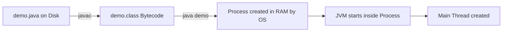
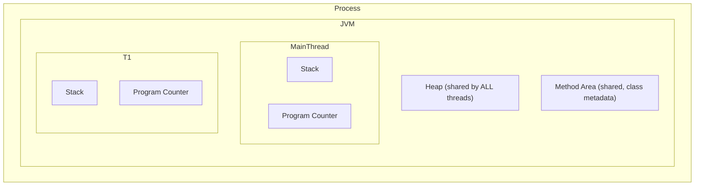
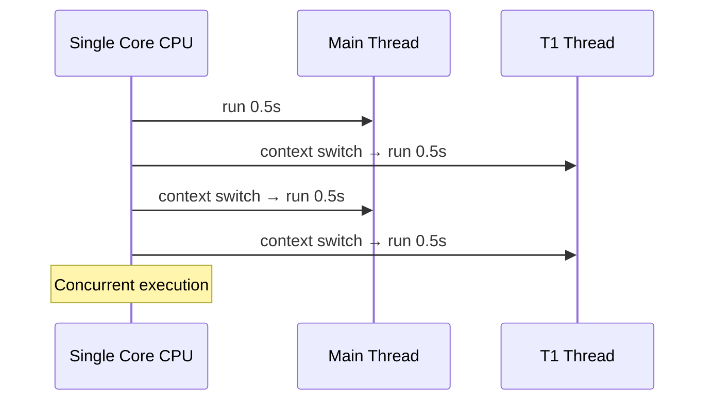
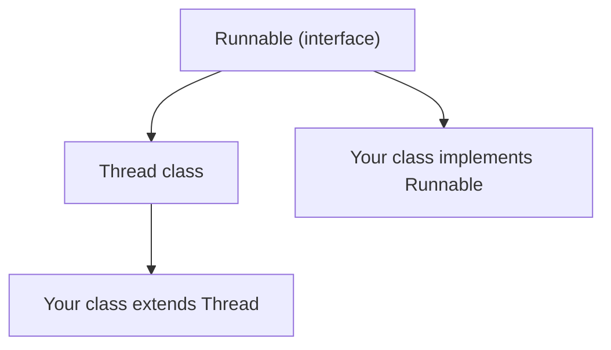
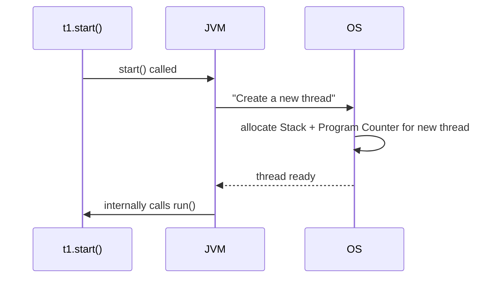
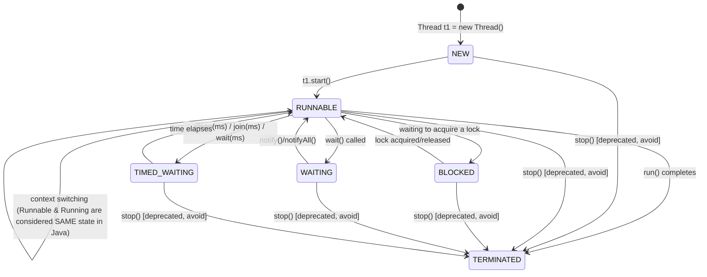
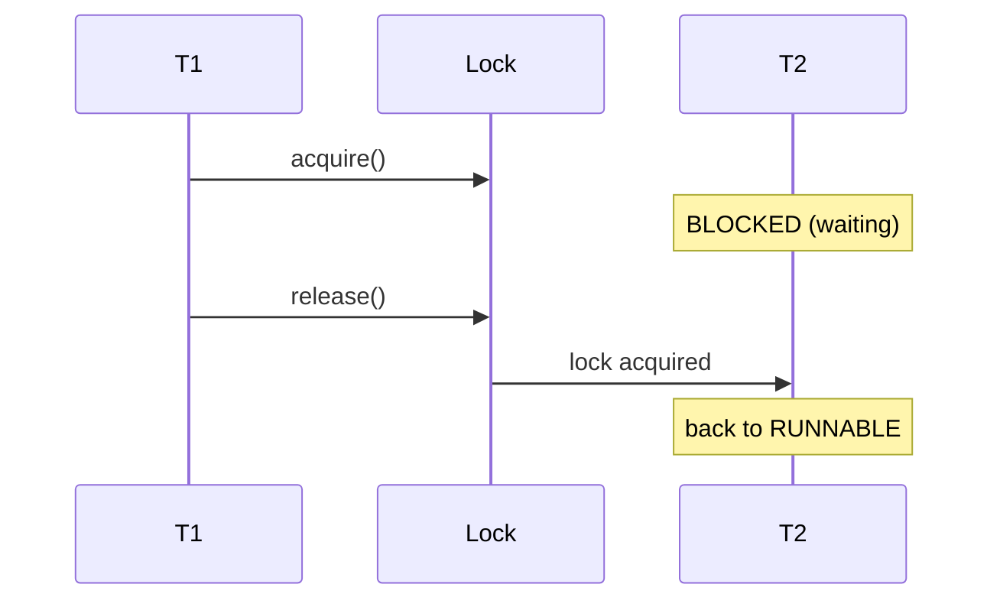
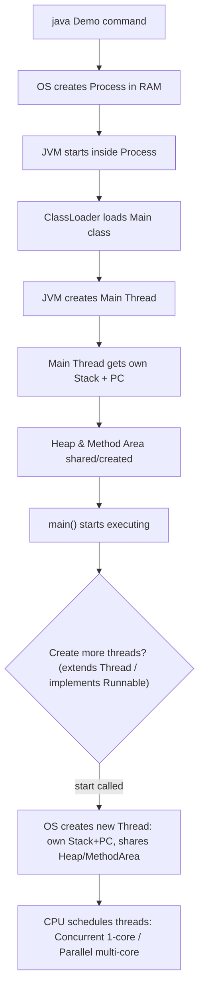

# Java Multithreading — Last-Minute Interview Notes

---

## 1. Program → Process → Thread

| Term | Meaning |
|---|---|
| **Program** | Set of instructions on **disk** (e.g. `Demo.java` → compiled to `Demo.class` bytecode). Not running = no meaning. |
| **Process** | A program **currently executing**. OS loads it from disk into **RAM**. Each process gets its own isolated memory — one process can never peek into another's memory. |
| **Thread** | Smallest sequence of instructions the **CPU executes independently**; a *lightweight process*. A process can have multiple threads. |



- CPU **never** talks to disk — only to RAM (via registers/cache).
- Every process needs: **RAM**, **CPU time**, **resources** (file/network) — all provided by the OS.

---

## 2. JVM Memory Layout (per Process)



- **Heap** & **Method Area** → shared across all threads.
- **Stack** & **Program Counter (PC)** → unique per thread.
- Flow on `java Demo`: OS creates **Process** → **JVM** starts inside it → **ClassLoader** loads Main class → JVM creates **Main Thread** → Main thread gets its own stack + PC → execution starts from `main()`.
- Why JVM manages its own memory (not OS directly)? → Java is **platform-independent**, so JVM abstracts memory (Heap, Stack, Method Area, PC, Native Stack) instead of relying on OS-specific (code/data/stack/register) segments.

---

## 3. Why Multithreading? (Interview trap!)

> ❌ **Common wrong answer:** "To make code run faster."
> ✅ Speed is the **least** important benefit — real benefit is doing multiple things **simultaneously** (e.g., IDE doing autocomplete + error-checking at once).

---

## 4. Concurrency vs Parallelism (VERY IMPORTANT)

| | Concurrency | Parallelism |
|---|---|---|
| Cores needed | 1 (single-core) | ≥2 (multi-core) |
| How | **Context Switching** — CPU rapidly switches between threads | Threads **truly execute at the same time** on different cores |
| Progress | Only **one thread progresses at a time**, but both make progress over time | Both threads progress **at the exact same instant** |
| Example | Main runs 0.5s → switch → T1 runs 0.5s → switch → Main... | Core1 runs Main, Core2 runs T1 — simultaneously |
| Total time (if each takes 3s) | ~6s (3s + 3s, due to switching overhead) | ~3s (true speed-up) |



**Context Switching**: On switch, CPU saves current thread's intermediate results & last executed instruction into that thread's **Stack** (operand stack) and **Program Counter**, then loads the next thread's stack/PC to resume it exactly where it left off.

- **Multithreading** = multiple threads of *one process* running (concurrently or in parallel).
- **Multitasking** = OS-level concept — multiple **processes** running together (Chrome, VS Code, Spotify). Internally the CPU still only ever schedules **threads**, never "processes" as a unit.

---

## 5. Creating Threads — 2 Ways

### Way 1: Extend `Thread` class
```java
class MyThread extends Thread {
    public void run() {
        System.out.println("Thread is running");
    }
}
// main
MyThread t1 = new MyThread();
t1.start();   // NOT t1.run()!
```

### Way 2: Implement `Runnable` interface (✅ Preferred)
```java
class MyRunnable implements Runnable {
    public void run() {
        System.out.println("Thread is running");
    }
}
// main
MyRunnable r1 = new MyRunnable();
Thread t1 = new Thread(r1);
t1.start();
```

### Way 2b: Runnable via Lambda (Runnable is a functional interface)
```java
Thread t1 = new Thread(() -> System.out.println("Thread is running"));
t1.start();
```

### Class Hierarchy


### Why prefer `Runnable` over extending `Thread`?
1. **Separation of concerns** — Runnable defines the *task*; Thread defines *how to run it*.
2. **Reusability** — same Runnable task object can be passed to multiple threads (T1, T2, T3...).
3. **No multiple-inheritance loss** — Java allows extending only **one class**. If you extend `Thread`, you can't extend anything else. Implementing an interface keeps that door open.
4. Runnable is a **functional interface** → allows **lambda expressions**.

---

## 6. Behind the Scenes of `start()`



### 🔑 `start()` vs `run()` — Classic Interview Question
- `t1.start()` → tells **OS** to create an actual new thread → OS then internally calls `run()`.
- `t1.run()` → **just a normal method call** on the current thread (e.g., main) — **no new thread is created**! Output will show `current thread = main`, not the new thread's name.

### 🔑 Can we call `start()` twice on the same thread?
❌ **No** → throws `IllegalThreadStateException`. Once a thread finishes (terminates), it cannot be restarted.

---

## 7. Thread Non-Determinism

- Order of thread execution is **never guaranteed** — depends on:
  - CPU scheduling algorithm (Round Robin, Priority-based, etc.) — **OS decides, not Java**
  - System load
  - Hardware (number of cores)
  - Thread creation time
- Running the same multi-threaded program twice can give **different output order** each time.
- This is why multithreaded code is hard to debug (non-reproducible bugs).

---

## 8. Thread Naming & ID

```java
Thread.currentThread().getName();   // get name of currently executing thread
Thread.currentThread().getId();     // deprecated! IDs are random, not sequential/meaningful
t1.setName("Worker-1");             // rename thread (useful for logging)
```

- Default main thread name = `"main"`, default ID = `1`.
- Custom threads get names like `Thread-0`, `Thread-1`, etc. unless renamed.
- `getId()` is **deprecated** — Java felt it gave false meaning (IDs aren't ordered/reusable-safe).

---

## 9. Thread Life Cycle (⭐ Most Asked Diagram)



### States explained
| State | Meaning |
|---|---|
| **NEW** | `new Thread()` created in code, but OS doesn't know about it yet. |
| **RUNNABLE** | `start()` called → OS created it & it's ready/executing. (Java treats "ready to run" and "actually running" as **ONE** state: `RUNNABLE`.) |
| **BLOCKED** | Waiting to acquire a **lock** on a critical section held by another thread. |
| **WAITING** | Put into indefinite wait via `wait()` — resumes only via `notify()`/`notifyAll()`. |
| **TIMED_WAITING** | Waiting for a fixed time via `sleep(ms)`, `join(ms)`, `wait(ms)`. |
| **TERMINATED** | `run()` method finished execution completely. |

Check state via enum:
```java
Thread.State state = t1.getState(); // NEW, RUNNABLE, BLOCKED, WAITING, TIMED_WAITING, TERMINATED
```

⚠️ **Key nuance**: `wait()`/`BLOCKED` release the monitor lock; `sleep()` (TIMED_WAITING) does **NOT** release any lock it's holding.

---

## 10. Critical Section & Locks (Conceptual Intro)

- **Critical Section** = a shared resource/code block accessed by multiple threads (e.g., shared `Student` object's `name` field).
- Problem: If T1 and T2 both modify it without control → **race condition** → unpredictable final result.
- Solution: **Locking** — only one thread can enter/acquire the lock on the critical section at a time; others go to **BLOCKED** state until the lock is released.



---

## 11. Important Thread Methods (⭐⭐⭐ Frequently Asked)

### `Thread.sleep(ms)`
- Static method — puts the **current thread** into `TIMED_WAITING` for given milliseconds.
- Throws checked `InterruptedException` → must wrap in try-catch.
- Does **NOT** release any lock it holds.
```java
try {
    Thread.sleep(2000);
} catch (InterruptedException e) { }
```

### `join()`
- Makes the calling thread **wait** until the target thread finishes.
- Overloaded with timeout: `t1.join(1000)` → wait max 1 second, then proceed regardless.
```java
Thread t1 = new Thread(() -> { /* work */ });
t1.start();
t1.join();          // main waits here until t1 finishes
System.out.println("main resumes");
```
- Used to bring **determinism** — ensures ordering.

### `yield()`
- Static method. Current thread **suggests** to OS: "I'm willing to give up CPU time to another thread of equal priority that's ready to run."
- **Just a request/hint** — OS/CPU may completely ignore it.
- Moves current thread only to `RUNNABLE` (never to waiting/blocked).
- **Rarely used in production** — mainly for testing/demonstrating scheduling.

### `interrupt()`
- Sends a **signal** (sets an internal boolean `interrupt flag` to `true`) — does **NOT** forcibly stop the thread.
- Used for **graceful shutdown** of long-running tasks / thread pools.
```java
Thread t1 = new Thread(() -> {
    while (!Thread.currentThread().isInterrupted()) {
        System.out.println("Running");
    }
});
t1.start();
Thread.sleep(2000);
t1.interrupt();   // gracefully signal stop after 2 sec
```
- If a thread is in `sleep()`/`wait()`/`join()` and gets interrupted → throws `InterruptedException` immediately.

#### `isInterrupted()` vs `interrupted()`
| Method | Static? | Behavior |
|---|---|---|
| `isInterrupted()` | No (instance) | Returns flag value, **does not reset** it |
| `interrupted()` | Yes (static) | Returns flag value, **resets flag to false** afterward |

### `isAlive()`
- Returns `true` if thread has been **started but not yet terminated**.
- `false` before `start()` and `false` after termination.

### `currentThread()`
- Static method → returns reference to the thread currently executing this line of code.
```java
Thread.currentThread().getName();
```

### Thread Priority
```java
t1.getPriority();      // default = Thread.NORM_PRIORITY = 5
t1.setPriority(Thread.MAX_PRIORITY); // 10 (MIN=1, NORM=5, MAX=10)
```
- Just a **hint** to OS scheduler — **not guaranteed** to be respected. OS may fully/partially/never honor it.

### Daemon Threads
- Background threads that **die automatically when all user (non-daemon) threads finish**, even mid-execution.
- Classic example: **Garbage Collector** runs as a daemon thread.
```java
Thread t1 = new Thread(() -> {
    while (true) System.out.println("Running");
});
t1.setDaemon(true);   // MUST be set BEFORE start()
t1.start();
```
- If main thread ends and t1 is daemon → t1 is killed immediately, regardless of its own loop.
- Normal (user) threads keep JVM alive until they finish, even if `main()` has returned.

---

## 12. Quick-Fire Interview Answers

| Question | Answer |
|---|---|
| Why multithreading? | NOT just speed — enables concurrent tasks (autocomplete + error check together). Speed gain only via true **parallelism** (multi-core). |
| Difference: Process vs Thread | Process = independent memory, isolated. Thread = lightweight, shares heap/method area with sibling threads of same process, only stack+PC are private. |
| Concurrency vs Parallelism | Concurrency = illusion via context switching (1 core). Parallelism = literally simultaneous (multi-core). |
| Multithreading vs Multitasking | Multithreading = multiple threads within ONE process. Multitasking = multiple PROCESSES running together (OS-level). CPU ultimately only schedules threads either way. |
| `start()` vs `run()` | `start()` creates a real OS thread & then calls run() internally. `run()` alone = just a normal synchronous method call on current thread. |
| Can you call `start()` twice? | No → `IllegalThreadStateException`. |
| Does `sleep()` release lock? | No. |
| Does `wait()`/blocked release lock? | Yes. |
| `yield()` guaranteed? | No, it's only a hint/suggestion to OS. |
| `interrupt()` forcibly stops thread? | No, just sets a flag — thread must check it (`isInterrupted()`) to respond gracefully. |
| Daemon vs User thread | Daemon dies when all user threads finish (e.g. GC); User thread keeps JVM alive till it completes. |
| Why prefer Runnable over extending Thread? | Separation of concerns, reusability, avoids losing single-inheritance slot, supports lambdas. |

---

## 13. Full Memory + Execution Flow (Summary Diagram)


