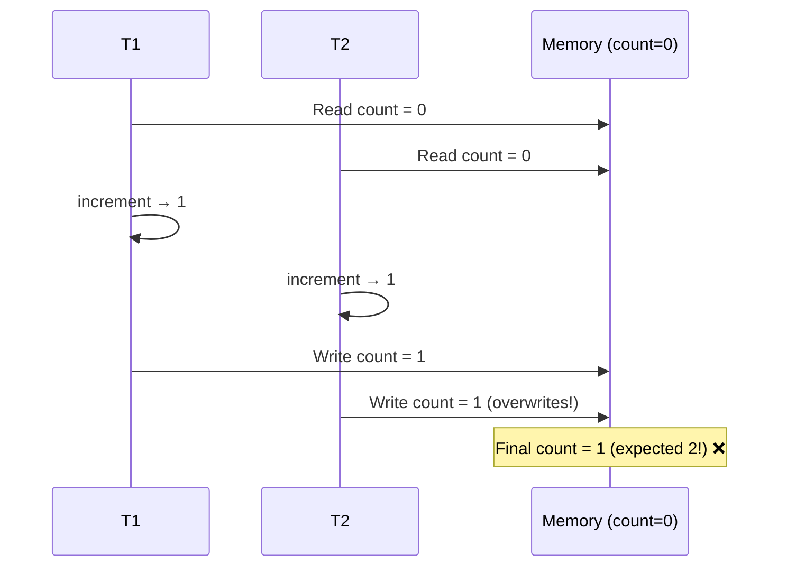
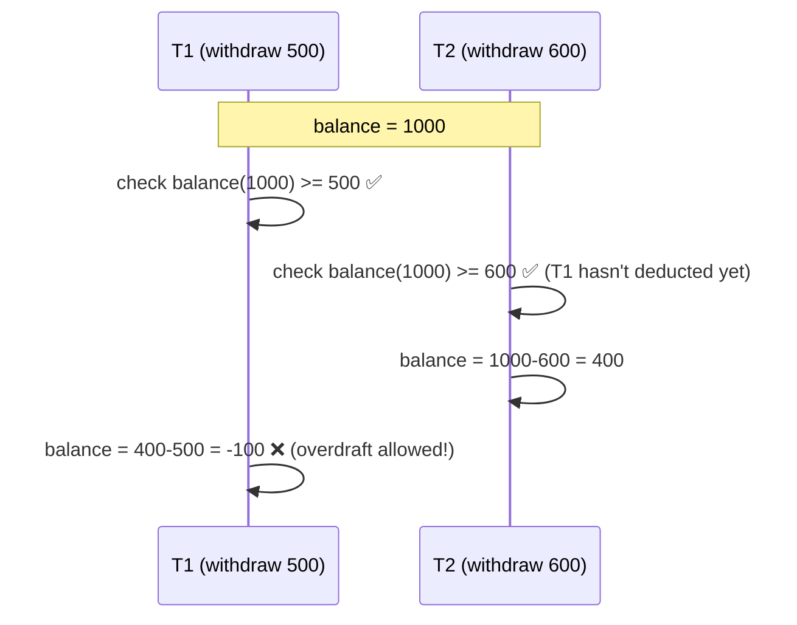
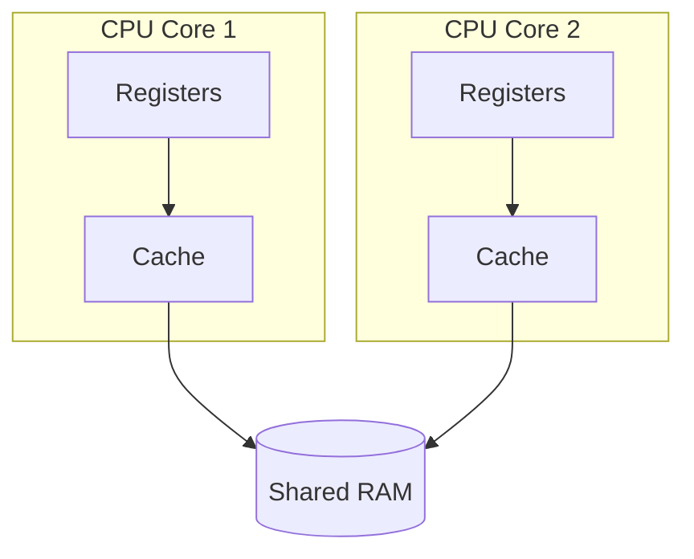
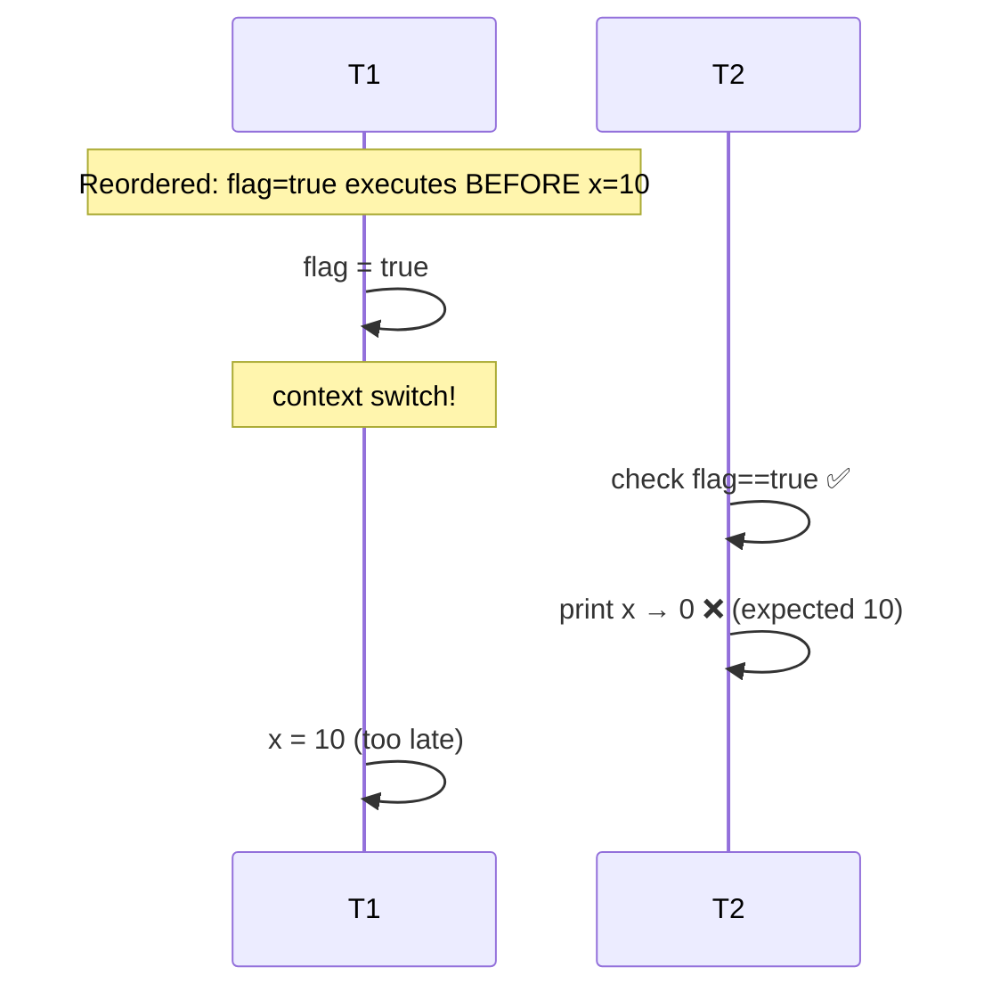
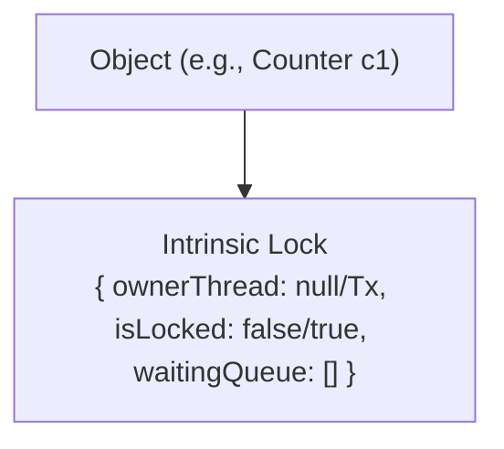
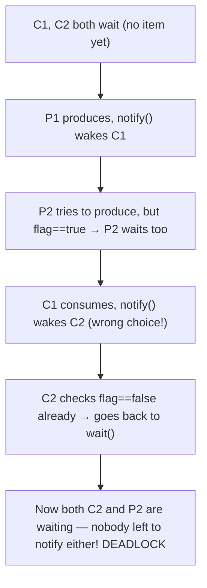
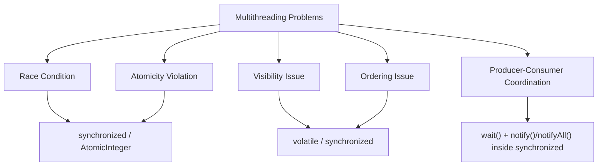

# Java Multithreading — Part 2: Problems & Solutions (Last-Minute Interview Notes)

> Continuation of Part 1 (Threads, Life Cycle). This part covers **problems** in multithreaded code (Race Condition, Atomicity, Visibility, Ordering) and their **solutions** (`synchronized`, locks, `volatile`, `wait`/`notify`/`notifyAll`).

---

## 1. Race Condition

**Definition:** Final output of the program depends on the **order/timing of thread execution** (which is non-deterministic) → program becomes **non-deterministic**.

### Classic Example: `count++`
```java
class Counter {
    public int count = 0;
    public void increment() {
        count++;   // NOT atomic!
    }
}
```
`count++` is internally **3 steps**:


### How Race Condition Occurs (interleaving)


- Happens even with **multiple cores** (parallel) — both may read `0` at the *exact same instant*.
- Demo: two threads each incrementing a shared counter 10,000 times → expected `20000`, actual output **varies every run** (e.g., 12109, 19669, 11864) due to lost updates.

### Critical Section & Shared Resource
| Term | Meaning |
|---|---|
| **Critical Section** | Code block accessed by multiple threads — risky zone (e.g., `increment()` method body). |
| **Shared Resource** | The actual data being contended (e.g., `count` variable, a shared `List`, an `Account` object). |

---

## 2. Atomicity Problem

**Atomic operation** = cannot be broken down further → executes fully or not at all, **no context switch can happen mid-way**.
**Non-atomic** = internally split into multiple steps → context switching can happen between steps → root cause of race conditions.

| Operation | Atomic? |
|---|---|
| `int x = 2;` (simple assignment) | ✅ Atomic |
| `Student s1 = new Student();` (reference assignment) | ✅ Atomic |
| `x++`, `x--`, `x += 5` (compound/increment-decrement) | ❌ Non-atomic (read-modify-write) |
| **Check-then-Act** (`if (balance >= amount) balance -= amount;`) | ❌ Non-atomic — classic bug source |
| `double d = 112.234;` on some 32-bit JVMs | ⚠️ Can be non-atomic (64-bit value written as two 32-bit writes) |

### Real-World Bug: Banking Check-then-Act
```java
if (balance >= amount) {
    balance = balance - amount;   // race window between check & act!
}
```

→ Combined withdrawal (₹1100) exceeded actual balance (₹1000). **Data inconsistency.**

### Fixes
- `synchronized` keyword (makes operation atomic via locking)
- `AtomicInteger`, `AtomicLong`, etc. (CAS-based, covered separately)

---

## 3. Visibility Problem

**Definition:** One thread updates a variable, but another thread doesn't see the updated value — because it's reading a **stale cached copy** instead of RAM.

### Why it happens (CPU cache architecture)

- T1 (Core 1) reads `flag=false` into its **own cache**, later sets it `true`, writes back to RAM.
- T2 (Core 2) already cached `flag=false` earlier — keeps reading from **its own cache**, never sees the update → **infinite loop**.

### Demo
```java
static boolean flag = false;

Thread t1 = new Thread(() -> {
    try { Thread.sleep(1000); } catch (InterruptedException e) {}
    flag = true;
});

Thread t2 = new Thread(() -> {
    while (!flag) {
        // busy loop — never exits without volatile!
    }
});
```
- ⚠️ Note: if you add `System.out.println(...)` inside the loop, it *accidentally* fixes it — because `println` is internally `synchronized`, which forces a RAM read. Without any print statement, the loop truly **never ends**.

### ✅ Fix: `volatile` keyword
```java
static volatile boolean flag = false;
```
- Forces **every read/write to go directly to RAM**, bypassing CPU cache.
- `volatile` solves **visibility** — it does **NOT** solve race conditions/atomicity!
  - ❌ `volatile int count = 0; count++;` → still has a race condition (visibility ≠ atomicity).
- `synchronized` also solves visibility (as a side effect of its locking/cache-flush mechanism), but has more overhead.

---

## 4. Ordering Problem

**Definition:** JVM/Compiler/CPU may **reorder instructions** for optimization, as long as it doesn't break *single-threaded* correctness. In multithreaded code, this reordering can produce unexpected results.

```java
// Thread 1
x = 10;
flag = true;

// Thread 2
if (flag == true) {
    System.out.println(x);   // could print 0 instead of 10!
}
```
- If reordered internally as `flag = true; x = 10;`, and a context switch happens right after `flag=true` but before `x=10` → Thread 2 sees `flag=true` but `x` is still `0`.



### Fixes
- `synchronized` (prevents reordering, uses locks)
- `volatile` (prevents reordering + ensures visibility, but not atomicity)

---

## 5. Thread Interference — Umbrella Term

**Thread Interference** = general term for bugs caused by multiple threads stepping on each other:
- Race Conditions
- Atomicity violations
- Visibility issues
- Ordering issues

**Root cause → Data Inconsistency** (the most dangerous outcome for any application).

### Solutions Toolbox
| Problem | Solution |
|---|---|
| Race Condition | `synchronized`, `AtomicInteger` |
| Atomicity | `synchronized`, Atomic classes (CAS) |
| Visibility | `volatile`, `synchronized` |
| Ordering | `volatile`, `synchronized` |

---

## 6. `synchronized` Keyword

### On a method
```java
class Counter {
    public int count = 0;
    public synchronized void increment() {
        count++;   // now safe!
    }
}
```
- Only **one thread at a time** can execute this method (or any synchronized method) **on the same object**.
- Other threads trying to enter → go to **BLOCKED** state until the lock is released.
- Fixes race condition completely: with `synchronized`, 10,000 + 10,000 increments = exactly `20000` every time.

### Synchronized Block (finer-grained locking — preferred for performance)
```java
class Counter {
    public int count = 0;
    public void increment() {
        synchronized (this) {
            count++;   // only this critical part is locked
        }
    }
}
```
- Advantage: only locks the risky part, not the whole method → less overhead, more concurrency for the rest of the code.

### Why prefer synchronized block over synchronized method?
- Repeated full-method locking = unnecessary overhead (acquire/release lock every call) even for non-critical code inside the method.

---

## 7. Monitor Locks / Intrinsic Locks — Deep Dive

- **Every Java object has an intrinsic (monitor) lock**, managed by the JVM.
- `synchronized` locks are **NOT tied to methods** — they're tied to the **object** (or the **Class** for static methods).



### 🔑 Golden Rules
1. **One object → one lock.** If `T1` locks `obj.method1()` and `T2` tries `obj.method2()` (also synchronized) — **T2 is BLOCKED** too, because both methods synchronize on the **same object's** lock.
2. **Two different objects → two different locks** → can run in **parallel** even if calling the "same" synchronized method — no interference.
3. **`synchronized` on a `static` method** locks the **Class object** (`ClassName.class`), NOT an instance. So a static synchronized method and an instance synchronized method do **NOT** block each other (different locks!).

```java
// Locks the whole class:
synchronized (Counter.class) { ... }
// equivalent to a synchronized static method
```

### ⚠️ Trap: New object every time = No real locking!
```java
synchronized (new Object()) {   // ❌ WRONG — new lock every call, no protection at all!
    // critical section
}
```

### Custom Lock Objects (for fine-grained parallel locking)
```java
class Bank {
    private final Object depositLock = new Object();
    private final Object withdrawLock = new Object();

    void deposit() {
        synchronized (depositLock) { /* deposit logic */ }
    }
    void withdraw() {
        synchronized (withdrawLock) { /* withdraw logic */ }
    }
}
```
- Now `deposit()` and `withdraw()` can run **in parallel** (different locks), while still being individually thread-safe (only one thread can deposit at a time, only one can withdraw at a time).

---

## 8. Conceptual Internal Working of `synchronized` (CAS-based)

```java
// Pseudocode for how a thread tries to acquire lock:
if (obj.lock.isLocked == false) {
    obj.lock.isLocked = true;
    obj.lock.ownerThread = currentThread;
    // enters critical section
} else {
    // added to obj.lock.waitingQueue (blocked state)
}
```
- This check-and-set itself must be **atomic** — guaranteed internally via **CAS (Compare-And-Swap)** hardware-level operation. (Covered in later videos — foundation of lock-free / optimistic locking.)

### Overhead Warning
- `synchronized` is a **pessimistic locking** mechanism → acquiring/releasing locks repeatedly is **expensive** and can slow down programs significantly.
- Production code often prefers **optimistic locking** / lock-free structures (e.g., `AtomicInteger` using CAS) for better performance.

---

## 9. Inter-Thread Communication: `wait()`, `notify()`, `notifyAll()`

- All 3 methods belong to `Object` class (not `Thread`!) — **because the lock/monitor and waiting queue live on the Object**, not on Thread.

### The Producer-Consumer Problem
```java
class Box {
    Integer item = null;
    boolean flag = false;   // true = item present

    void producer(int value) {
        item = value;
        flag = true;
    }
    void consumer() {
        item = null;
        flag = false;
    }
}
```
**Two failure scenarios** (non-deterministic order):
1. Consumer runs before Producer → consumes `null`.
2. Producer runs twice before Consumer consumes → overwrites unconsumed data.

⚠️ Just adding `synchronized` does **NOT** fix this — synchronized only ensures **one thread at a time**, it can't coordinate *which* thread should run *when* based on a condition.

### ❌ Naive/Busy-Waiting Solution (wastes CPU)
```java
// BAD: busy-waiting — spins the CPU doing nothing useful
while (flag == true) { /* do nothing, just spin */ }   // producer waits
while (flag == false) { /* do nothing, just spin */ }  // consumer waits
```
- Wastes CPU cycles endlessly checking a condition ("busy waiting").
- Adding `synchronized` here to fix the race condition on `flag` → causes **DEADLOCK** (if consumer enters first, it spins forever *while holding the lock*, so producer can never enter to set flag = true).

### ✅ Correct Solution: `wait()` + `notify()`

**`wait()` does 3 things:**
1. Releases all monitor locks held by the thread.
2. Puts thread into **WAITING** state.
3. Stays there **indefinitely** until another thread calls `notify()`/`notifyAll()` on the same object.

**`notify()`:**
1. Picks **one random thread** from the object's waiting queue.
2. Moves it from WAITING → **BLOCKED** (not directly runnable — it must re-acquire the lock first!).
3. Once it acquires the lock → BLOCKED → RUNNABLE.

```java
class Box {
    Integer item = null;
    boolean flag = false;

    synchronized void produce(int value) throws InterruptedException {
        while (flag == true) {
            wait();              // wait if item already present
        }
        item = value;
        flag = true;
        System.out.println("Produced: " + item);
        notify();                 // wake up a waiting consumer
    }

    synchronized void consume() throws InterruptedException {
        while (flag == false) {
            wait();               // wait if nothing to consume
        }
        System.out.println("Consumed: " + item);
        item = null;
        flag = false;
        notify();                 // wake up a waiting producer
    }
}
```

```mermaid
sequenceDiagram
participant P as Producer Thread
participant C as Consumer Thread
participant Box
C->>Box: consume() acquires lock
Note over C: flag==false → wait() → releases lock, goes to WAITING
P->>Box: produce() acquires lock (now free)
P->>Box: sets item, flag=true
P->>C: notify() → C moves WAITING → BLOCKED → RUNNABLE
P->>Box: releases lock (exits synchronized method)
C->>Box: re-acquires lock, resumes after wait(), consumes item
```

### ⚠️ Rule: `wait()`/`notify()`/`notifyAll()` MUST be called inside a `synchronized` block/method
- Otherwise → `IllegalMonitorStateException` (can't release/notify on a lock you don't hold).

### 🔑 `notify()` vs `notifyAll()`

| | `notify()` | `notifyAll()` |
|---|---|---|
| Wakes | ONE random waiting thread | ALL waiting threads |
| Risk | Can cause **deadlock** with multiple producers/consumers (wrong thread woken repeatedly, others starve forever) | Safe — everyone gets a chance to recheck condition |
| Overhead | Lower | Higher (wakes threads that may just re-wait) |
| When to use | Only when you're SURE there's exactly 1 producer & 1 consumer thread type | **Always prefer** with multiple producers/consumers |

#### Why `notify()` can deadlock with multiple producers/consumers

→ Always use `notifyAll()` when multiple producer/consumer threads exist.

---

## 10. Spurious Wakeup & Guarded Blocks

- **Spurious Wakeup**: a thread may leave the WAITING state **without** an actual `notify()`/`notifyAll()` call (rare OS/JVM-level occurrence).
- **Fix:** ALWAYS re-check the condition in a **`while` loop**, never a plain `if`:
```java
while (flag == false) {   // ✅ guarded block — re-checks condition after waking up
    wait();
}
```
- If you used `if` instead of `while`, a spurious wakeup would let the thread proceed **without the condition actually being true** → bug (e.g., consuming a `null` item).
- This `while(condition) { wait(); }` pattern is called a **Guarded Block**.

---

## 11. `sleep()` vs `wait()` — Interview Favorite

| | `Thread.sleep(ms)` | `object.wait()` |
|---|---|---|
| Belongs to | `Thread` class (static) | `Object` class |
| State | `TIMED_WAITING` | `WAITING` (or `TIMED_WAITING` if `wait(ms)` overload used) |
| Releases lock? | ❌ No | ✅ Yes (releases monitor lock) |
| Wakes up via | Time elapses | `notify()`/`notifyAll()` (or timeout if `wait(ms)`) |
| Needs synchronized block? | No | ✅ Yes — else `IllegalMonitorStateException` |

---

## 12. Quick-Fire Interview Q&A

| Question | Answer |
|---|---|
| What is a race condition? | Output depends on non-deterministic thread execution order/timing. |
| Root cause of race condition in `count++`? | It's non-atomic — 3 internal steps (read, increment, write) allow interleaving. |
| What is atomicity? | Operation executes fully or not at all — no partial/interrupted execution. |
| Is `x++` atomic? | No. Simple assignment (`x = 5`) and object reference assignment ARE atomic; increment/decrement/compound ops are NOT. |
| What is "check-then-act"? | Checking a condition then acting on it in separate non-atomic steps — classic race-condition source (e.g., bank balance check). |
| What is the visibility problem? | A thread's cached value doesn't reflect another thread's update in RAM. |
| Fix for visibility? | `volatile` (or `synchronized`). |
| Does `volatile` fix race conditions? | ❌ No — only visibility. Atomicity/race conditions need `synchronized`/Atomic classes. |
| What is the ordering problem? | JVM/CPU/compiler reorders instructions for optimization; can break multithreaded assumptions. |
| Fix for ordering? | `volatile` or `synchronized`. |
| What does `synchronized` lock — the method or the object? | The **object's monitor lock** (or Class for static methods), not the method itself. |
| Can two threads run two different synchronized methods on the SAME object simultaneously? | ❌ No — same object = same lock. |
| Can two threads run synchronized methods on TWO DIFFERENT objects simultaneously? | ✅ Yes — different locks. |
| What happens if you `synchronized(new Object())` every time? | Defeats the purpose — every thread gets a fresh, uncontested lock, so no real protection. |
| Where do `wait`/`notify`/`notifyAll` live and why? | In `Object` class — because the monitor lock & waiting queue belong to the object, not the thread. |
| What must wrap `wait()`/`notify()`? | A `synchronized` block/method — else `IllegalMonitorStateException`. |
| `notify()` vs `notifyAll()` — which is safer? | `notifyAll()` — avoids deadlocks with multiple producers/consumers; `notify()` risks waking the "wrong" thread forever. |
| Why use `while` instead of `if` around `wait()`? | To guard against spurious wakeups — recheck condition after waking up. |
| Difference: `sleep()` vs `wait()`? | `sleep()` doesn't release lock, time-based, on Thread class. `wait()` releases lock, waits indefinitely until notified, on Object class. |
| What is thread interference? | Umbrella term for bugs from race conditions, atomicity, visibility, ordering issues across threads → causes data inconsistency. |

---

## 13. Full Problem → Solution Map (Summary)


