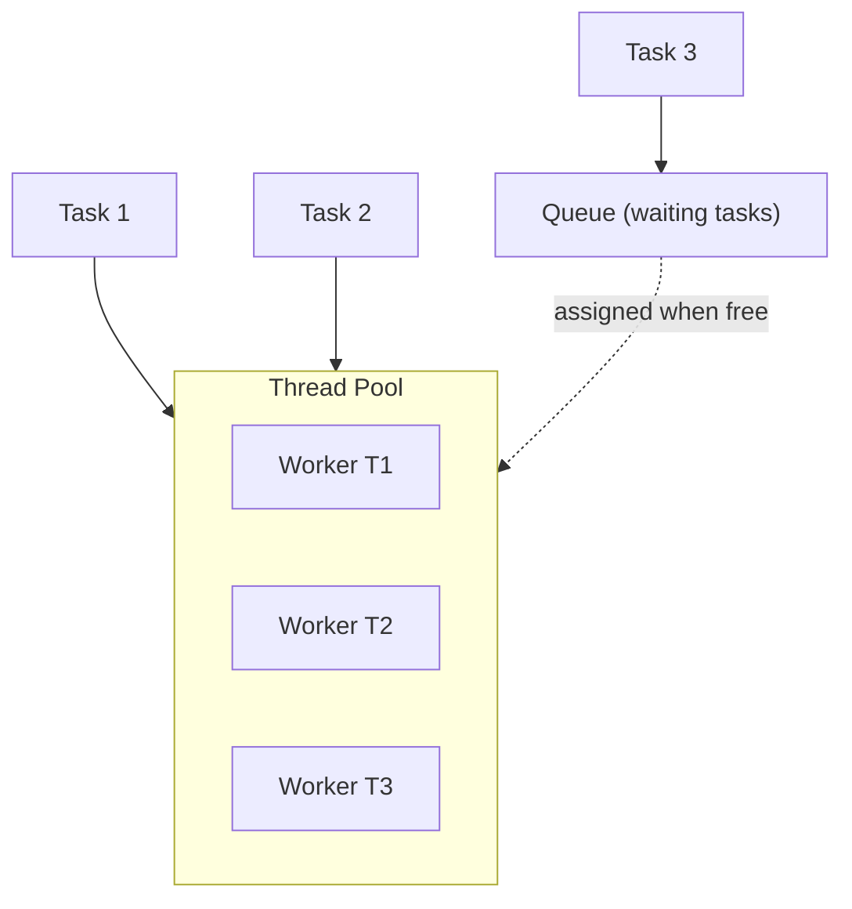
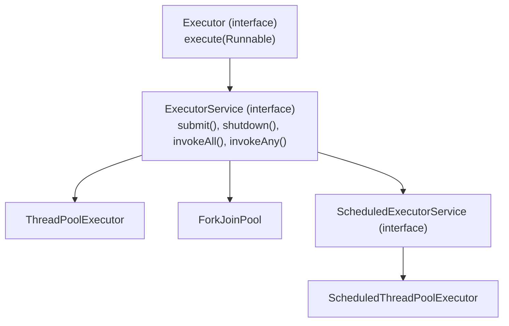
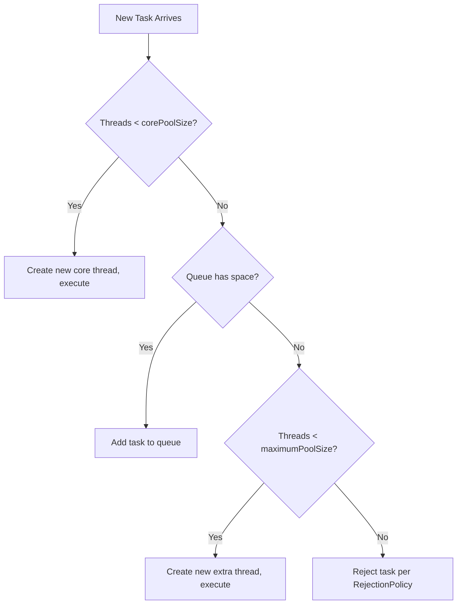
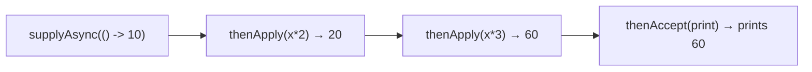
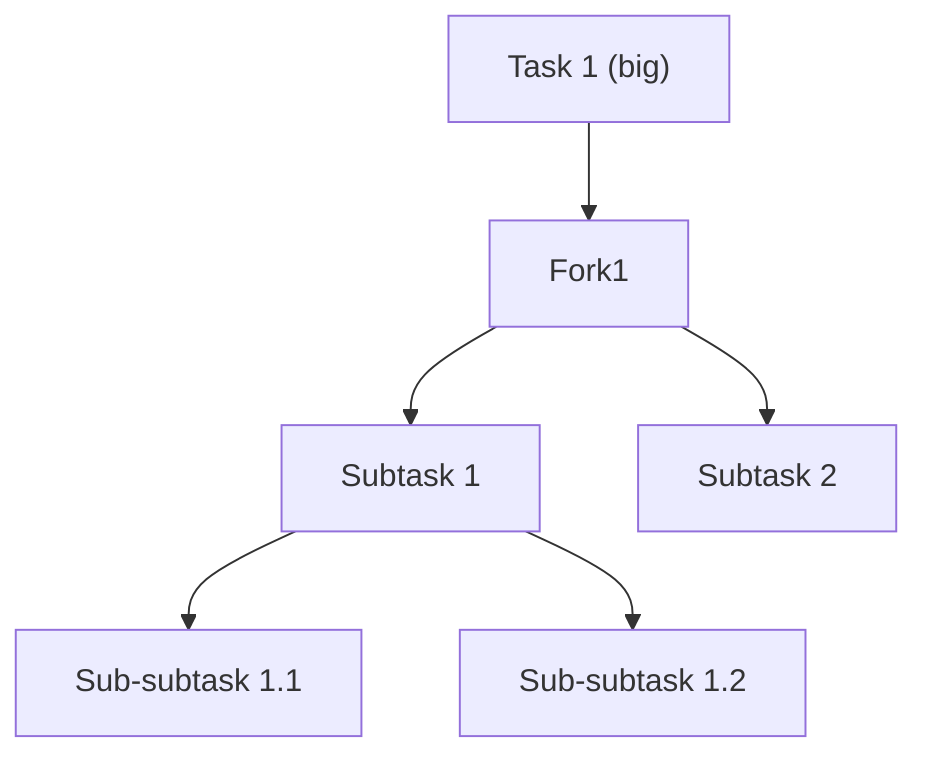
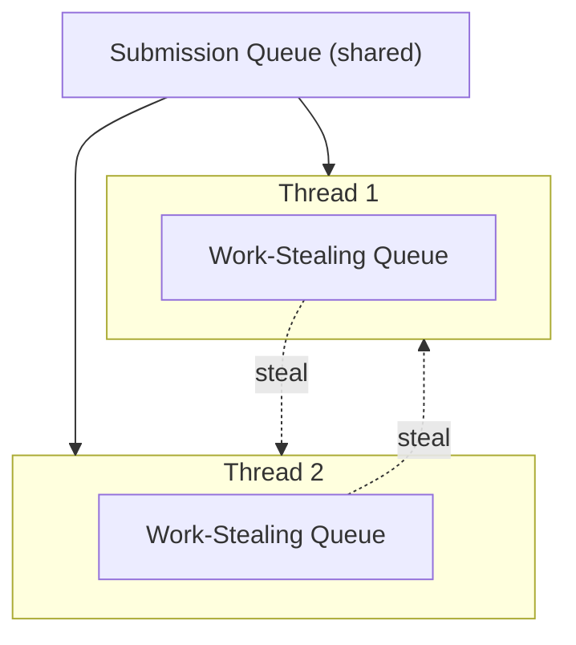
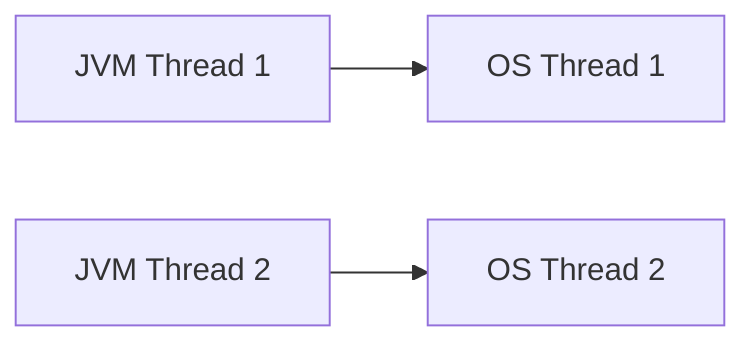
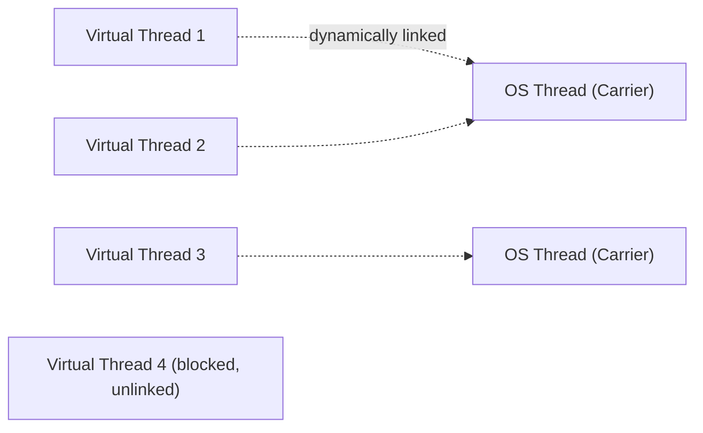

# Java Multithreading — Part 3: Executor Framework & Beyond (Last-Minute Interview Notes)

> Continuation of Parts 1 & 2. Covers **Executor Framework, Thread Pools, Future, CompletableFuture, Fork-Join Pool, ThreadLocal, Virtual Threads** — the most production-relevant topics.

---

## 1. Why Executor Framework? (Problem with Manual Thread Creation)

Manually creating threads (`new Thread(...).start()`) for every task is wasteful:

| Problem | Explanation |
|---|---|
| **Memory allocation** | Each thread takes ~512 KB – 1 MB (stack space). 1000 threads ≈ 500MB–1GB wasted. |
| **OS Scheduling / Thrashing** | Too many threads on limited cores → excessive **context switching** ("thrashing") — CPU spends more time switching than doing actual work. |
| **Thread creation time** | Creating a thread involves OS system calls — expensive & slow, especially if repeated for every task. |
| **One-time use** | Threads created manually are typically used once and discarded — like **hiring and firing a chef for every single dish**. |

### ✅ Solution: Executor Framework
> "Just give me the **task**. I'll handle **how** to execute it (thread creation, reuse, scheduling)."

---

## 2. Thread Pool — Core Concept



- Pool has pre-created **worker threads**. Task assigned → worker executes it → **worker returns to pool** (NOT terminated) → reused for next task.
- If all workers busy → task goes to a **Queue**.
- If queue is full & more capacity allowed → create **new worker thread** (up to max limit).
- If both pool and queue are full → **reject / discard** the task (per rejection policy).

### 🏢 Real-world analogy
Client requests (C1, C2, C3...) → limited worker threads handle them → excess requests queued → prevents creating unlimited threads (which would crash the server). This is the **backbone of web servers / Spring Boot**.

---

## 3. Executor Framework Hierarchy



| Interface/Class | Purpose |
|---|---|
| `Executor` | Single method: `void execute(Runnable command)` |
| `ExecutorService` | Adds `submit()`, `shutdown()`, `shutdownNow()`, `invokeAll()`, `invokeAny()` |
| `ThreadPoolExecutor` | Standard configurable thread pool |
| `ForkJoinPool` | Divide-and-conquer style pool (work-stealing) |
| `ScheduledThreadPoolExecutor` | Run tasks after a delay / periodically |

---

## 4. Creating & Using an Executor

```java
ExecutorService executor = Executors.newFixedThreadPool(2); // 2 worker threads

for (int i = 1; i <= 5; i++) {
    int taskId = i; // must be effectively final for lambda
    executor.execute(() -> {
        System.out.println("Task " + taskId + " performed by " + Thread.currentThread().getName());
    });
}

executor.shutdown(); // ⚠️ ALWAYS call this!
```
- 5 tasks, only 2 worker threads → 3 tasks wait in queue, get picked up as workers free up.

---

## 5. `execute()` vs `submit()`

| | `execute(Runnable)` | `submit(Callable / Runnable)` |
|---|---|---|
| Input | `Runnable` only | `Callable` (has return value) or `Runnable` |
| Return value | None (`void`) | Returns a `Future<T>` |
| Exception handling | **Exception is LOST** — can't be caught in calling thread (happens in a different thread) | Exception is **captured** inside the `Future` — surfaces when you call `.get()` |

```java
// execute — Runnable, no return, exception lost
executor.execute(() -> { int x = 10/0; });  // exception silently disappears!

// submit — Callable, returns Future, exception captured
Future<Integer> f1 = executor.submit(() -> 10/0);
try {
    f1.get();  // this WILL throw ExecutionException — catchable!
} catch (Exception e) {
    System.out.println("Caught: " + e);
}
```

---

## 6. `Callable` vs `Runnable`

| | `Runnable` | `Callable<V>` |
|---|---|---|
| Method | `void run()` | `V call()` |
| Return value | ❌ None | ✅ Returns a value |
| Checked exceptions | Cannot throw | Can throw |

---

## 7. `Future<V>` — Handling Async Results

```java
ExecutorService executor = Executors.newFixedThreadPool(2);
Future<Integer> f1 = executor.submit(() -> {
    Thread.sleep(3000);
    return 10;
});
int result = f1.get();  // BLOCKS current thread until result is ready
```

### Key `Future` methods
| Method | Behavior |
|---|---|
| `get()` | **Blocks** current thread until result available. Throws `InterruptedException`, `ExecutionException`. |
| `get(timeout, unit)` | Blocks only up to timeout → throws `TimeoutException` if not ready. |
| `isDone()` | Non-blocking check if task completed (`true`/`false`). |
| `cancel(boolean mayInterruptIfRunning)` | Tries to cancel task. If not started → cancels easily. If running & `true` passed → attempts `interrupt()`. If `false` → lets it finish. |
| `isCancelled()` | Was the task cancelled? |

⚠️ **Anti-pattern**: calling `.get()` immediately after `.submit()` on the very next line defeats the purpose of async execution — it just makes it synchronous again (blocks main thread anyway). Do other work between submit and get!

### Submit overloads
```java
executor.submit(Callable<T>);              // returns Future<T> with actual result
executor.submit(Runnable);                  // returns Future<?> — result is null
executor.submit(Runnable, T predefinedResult); // returns Future<T> with your custom result on completion
```

---

## 8. `ExecutorService` Key Methods Summary

| Method | Purpose |
|---|---|
| `execute(Runnable)` | Fire-and-forget, no return, exceptions lost |
| `submit(Callable/Runnable)` | Returns `Future`, exceptions captured |
| `shutdown()` | Stop accepting new tasks; let running/queued tasks finish, then terminate |
| `shutdownNow()` | Attempt to stop everything immediately (not guaranteed — just a request/interrupt) |
| `invokeAll(List<Callable>)` | Submit multiple tasks at once → returns `List<Future>` |
| `invokeAny(...)` | (rarely used) returns result of first successfully completed task |

---

## 9. `ThreadPoolExecutor` — Manual Configuration

```java
ThreadPoolExecutor executor = new ThreadPoolExecutor(
    2,                              // corePoolSize
    5,                              // maximumPoolSize
    10,                             // keepAliveTime
    TimeUnit.SECONDS,               // time unit
    new ArrayBlockingQueue<>(5)     // work queue (bounded)
);
```

| Parameter | Meaning |
|---|---|
| `corePoolSize` | Minimum number of threads always kept alive |
| `maximumPoolSize` | Max threads allowed (extra ones created only when queue is full) |
| `keepAliveTime` + `TimeUnit` | How long **extra** (beyond core) idle threads survive before being killed |
| `workQueue` | Holds pending tasks when all core threads are busy |

### Task Assignment Rule (order of decision)


### Queue Types
| Type | Behavior |
|---|---|
| `ArrayBlockingQueue(capacity)` | **Fixed size** |
| `LinkedBlockingQueue()` | **Unbounded** (can grow infinitely → risk of memory issues!) |

### Rejection Policies (when pool + queue both full)
| Policy | Behavior |
|---|---|
| `AbortPolicy` (default) | Throws `RejectedExecutionException` |
| `DiscardPolicy` | Silently drops the task (⚠️ risk of silent data loss) |
| `DiscardOldestPolicy` | Removes oldest queued task, adds the new one (✅ commonly used in real systems) |

---

## 10. Built-in Executors (`Executors` utility class)

| Factory Method | Behavior |
|---|---|
| `newFixedThreadPool(n)` | Fixed `n` threads + **unbounded queue** (⚠️ risk of memory issues under heavy load) |
| `newCachedThreadPool()` | **Unlimited threads created on-demand** + **no queue**. Idle threads die after 60s. Good for bursty short tasks, risky under heavy sustained load. |
| `newSingleThreadExecutor()` | **1 thread only** + queue → serializes all tasks (one at a time, in order). Good for logging systems where order matters. |
| `newScheduledThreadPool(n)` | Schedule delayed / periodic tasks |

### Scheduled Executor
```java
ScheduledExecutorService scheduler = Executors.newScheduledThreadPool(1);

// Run once, after 2 second delay
scheduler.schedule(() -> System.out.println("Hello"), 2, TimeUnit.SECONDS);

// Run repeatedly: first at 0s, then every 2s
scheduler.scheduleAtFixedRate(() -> System.out.println("Tick"), 0, 2, TimeUnit.SECONDS);
```

---

## 11. `CompletableFuture` — Advanced, Non-Blocking Async

### Limitations of plain `Future` (why `CompletableFuture` exists)
1. `get()` is **blocking** — kills the whole point of async execution.
2. **Cannot chain/combine** multiple async results together.

### Creating
```java
CompletableFuture<Integer> f1 = CompletableFuture.supplyAsync(() -> 10); // has return value
CompletableFuture<Void> f2 = CompletableFuture.runAsync(() -> System.out.println("hi")); // no return value
```
- Uses **ForkJoinPool** internally by default (can pass your own `Executor` as 2nd arg if needed).

### Chaining methods
| Method | Input → Output | Use |
|---|---|---|
| `thenApply(Function)` | takes previous result, **returns** a new value | Transform result |
| `thenAccept(Consumer)` | takes previous result, **returns nothing** | Consume/print result (ends chain, returns `CompletableFuture<Void>`) |
| `thenRun(Runnable)` | **no input, no output** | Just run something after completion |
| `thenCombine(otherFuture, BiFunction)` | combines results of **two** independent futures | Merge parallel async results |

```java
CompletableFuture<Void> chain = CompletableFuture.supplyAsync(() -> 10)
    .thenApply(result -> result * 2)      // 10 → 20
    .thenApply(result -> result * 3)      // 20 → 60
    .thenAccept(result -> System.out.println(result)); // prints 60
```

```java
CompletableFuture<Integer> f1 = CompletableFuture.supplyAsync(() -> 10);
CompletableFuture<Integer> f2 = CompletableFuture.supplyAsync(() -> 20);
CompletableFuture<Integer> result = f1.thenCombine(f2, (a, b) -> a + b); // 30
result.thenAccept(System.out::println);
```



**Key benefit**: entire chain is **non-blocking** — main thread keeps running; only `.get()` blocks (and you rarely need to call it).

---

## 12. Fork-Join Pool — Divide & Conquer Parallelism

### Concept
Break a big task into smaller **subtasks** recursively (like Divide & Conquer in DSA) → execute independently → **join** (combine) results.



### Architecture: Submission Queue + Work-Stealing Queues

- Each worker thread has its **own private work-stealing queue**.
- A thread executes its own subtask directly, pushes the other half into its own queue.
- **Idle threads "steal" work** from other threads' queues when they run out of their own tasks (hence "work-stealing").
- Priority: check **Submission Queue** first, then steal from peers' queues.

### Implementation: `RecursiveTask` / `RecursiveAction`
| Class | Use when |
|---|---|
| `RecursiveTask<V>` | Your subtask **returns** a value |
| `RecursiveAction` | Your subtask does **not** return anything |

### Example: Sum of array using Fork-Join
```java
class SumTask extends RecursiveTask<Integer> {
    private int[] arr;
    private int start, end;

    public SumTask(int[] arr, int start, int end) {
        this.arr = arr; this.start = start; this.end = end;
    }

    @Override
    protected Integer compute() {
        // BASE CASE
        if (end - start <= 2) {
            int sum = 0;
            for (int i = start; i <= end; i++) sum += arr[i];
            return sum;
        }
        // DIVIDE
        int mid = (start + end) / 2;
        SumTask leftTask = new SumTask(arr, start, mid);
        SumTask rightTask = new SumTask(arr, mid + 1, end);

        leftTask.fork();                 // push left task to work-stealing queue (async)
        int rightResult = rightTask.compute(); // do right half in current thread
        int leftResult = leftTask.join();      // wait & get left half result

        // JOIN / COMBINE
        return leftResult + rightResult;
    }
}

// Usage
int[] arr = {1,2,3,4,5,6,7,8};
ForkJoinPool pool = new ForkJoinPool();
SumTask task = new SumTask(arr, 0, arr.length - 1);
int result = pool.invoke(task);   // 36
pool.shutdown();
```

### Key methods
| Method | Meaning |
|---|---|
| `fork()` | Submit subtask asynchronously to its own work-stealing queue |
| `compute()` | Execute subtask (recursively divides until base case) |
| `join()` | Block until the forked subtask completes, then get its result |
| `pool.invoke(task)` | Entry point — runs task on the fork-join pool and blocks for final result |

---

## 13. `ThreadLocal<T>`

**Problem**: Heap memory (instance fields) is **shared** across all threads → risk of race conditions if each thread needs its own private value for the same field.

**Solution**: `ThreadLocal` gives **each thread its own private copy** of a variable.

```java
class Resource {
    ThreadLocal<String> name = new ThreadLocal<>();
}

Resource r = new Resource();

Thread t1 = new Thread(() -> {
    r.name.set("Aditya");
    System.out.println(r.name.get()); // Aditya
});

Thread t2 = new Thread(() -> {
    r.name.set("Rohit");
    System.out.println(r.name.get()); // Rohit
});

t1.start();
t2.start();
```
- No race conditions, no locks needed — each thread reads/writes its **own copy**.
- Different from a local variable: a local variable dies when the method scope ends; `ThreadLocal` fields live inside a heap object but still stay **thread-private** for the object's lifetime.
- Common use: per-thread DB connections, per-request user context (e.g., in web servers), SimpleDateFormat instances, etc.

---

## 14. Virtual Threads (Project Loom)

### Traditional Threads — 1:1 Mapping Problem

- Every JVM `Thread` is **directly linked 1:1** to a real OS thread.
- Problems:
  1. Creating too many OS threads is expensive (memory + context-switch overhead).
  2. If a JVM thread blocks (I/O, waiting) → the underlying **OS thread is also blocked and wasted** — can't be reused for other work.

### Virtual Threads — Many-to-Few Mapping

- You can create **thousands/millions** of lightweight virtual threads — managed entirely by the **JVM**, not the OS.
- A virtual thread is only **linked to a real OS ("carrier") thread** when it actually needs to execute.
- **If a virtual thread blocks (I/O wait, lock wait)** → JVM automatically **unmounts** it from the OS thread and mounts a different ready virtual thread instead → OS thread is never wasted idling.
- Mapping is **1 OS thread : many Virtual threads** (many-to-few), unlike traditional 1:1.

### Creating Virtual Threads
```java
// Direct creation
Thread t1 = Thread.startVirtualThread(() -> {
    System.out.println(Thread.currentThread());
});
t1.join();
```

```java
// Via Executor (preferred / production usage)
ExecutorService executor = Executors.newVirtualThreadPerTaskExecutor();

for (int i = 1; i <= 5; i++) {
    executor.submit(() -> {
        System.out.println("Task executed by " + Thread.currentThread());
    });
}
executor.shutdown();
```

### When to use Virtual Threads
- High-concurrency I/O-bound workloads: web servers handling **thousands of simultaneous requests**, each doing DB/API calls that involve waiting.
- Massively better scalability than traditional thread pools for such workloads — no need to artificially limit concurrency to protect the OS.

---

## 15. Quick-Fire Interview Q&A

| Question | Answer |
|---|---|
| Why not create threads manually for every task? | Expensive: memory, OS scheduling overhead (thrashing/context-switching), thread creation time, one-time-use waste. |
| What does Executor Framework provide? | Manages thread pools internally — you just submit tasks (`Runnable`/`Callable`); framework handles thread creation/reuse/scheduling. |
| Difference: `execute()` vs `submit()`? | `execute()` takes `Runnable`, no return, exceptions lost. `submit()` takes `Callable`/`Runnable`, returns `Future`, exceptions captured. |
| Difference: `Runnable` vs `Callable`? | `Runnable.run()` returns nothing, can't throw checked exceptions. `Callable.call()` returns a value, can throw exceptions. |
| Why does `Future` exist? | Because async task results aren't available immediately — a normal variable can't hold a "value that will arrive later." |
| Is `Future.get()` blocking? | Yes — blocks calling thread until result available (or timeout, if `get(timeout,unit)` used). |
| Biggest limitations of `Future`? | (1) Blocking `get()`. (2) Can't chain/combine multiple async computations. |
| How does `CompletableFuture` fix these? | Non-blocking chaining via `thenApply`/`thenAccept`/`thenRun`/`thenCombine`. |
| Difference: `thenApply` vs `thenAccept` vs `thenRun`? | `thenApply` transforms & returns a value. `thenAccept` consumes value, returns nothing. `thenRun` ignores input entirely, just runs an action. |
| What pool does `CompletableFuture` use by default? | `ForkJoinPool.commonPool()` (unless you pass a custom executor). |
| Core principle of Fork-Join Pool? | Divide & conquer — split task into subtasks recursively, execute in parallel, combine (join) results. |
| What is work-stealing? | Idle threads "steal" pending subtasks from busy threads' own queues to maximize parallel utilization. |
| `RecursiveTask` vs `RecursiveAction`? | `RecursiveTask` returns a value; `RecursiveAction` does not. |
| `fork()` vs `join()`? | `fork()` = submit subtask asynchronously. `join()` = wait for that subtask's result. |
| corePoolSize vs maximumPoolSize? | Core = minimum threads always alive. Max = ceiling threads allowed when queue is full. |
| When are "extra" threads (beyond core) created? | Only after the queue is completely full and current threads < maximumPoolSize. |
| What happens if pool + queue both full? | Task is handled per **RejectionPolicy**: Abort (throw exception, default), Discard (silently drop), DiscardOldest (drop oldest queued task, add new one — most common in practice). |
| `newFixedThreadPool` vs `newCachedThreadPool` vs `newSingleThreadExecutor`? | Fixed = N threads + unbounded queue. Cached = unlimited on-demand threads + no queue (risk if overloaded). Single = 1 thread, fully serialized execution. |
| What problem does `ThreadLocal` solve? | Gives each thread its own private copy of a variable, avoiding race conditions on shared heap fields without needing locks. |
| Why do Virtual Threads help scalability? | They're JVM-managed, cheap, and unmount from OS threads while blocked (I/O/lock wait) — OS threads never sit idle, enabling massive concurrency (thousands+ virtual threads on very few OS threads). |
| Mapping ratio: traditional threads vs virtual threads? | Traditional: 1 JVM thread : 1 OS thread. Virtual: many JVM (virtual) threads : few OS (carrier) threads, dynamically mounted/unmounted. |
| How to create a virtual thread quickly? | `Thread.startVirtualThread(runnable)` or `Executors.newVirtualThreadPerTaskExecutor()`. |

---

## 16. Full Picture: Executor Ecosystem Summary

```mermaid
graph TD
A[Task: Runnable/Callable] --> B[ExecutorService]
B --> C1[ThreadPoolExecutor: general purpose]
B --> C2[ForkJoinPool: divide & conquer, work-stealing]
B --> C3[ScheduledThreadPoolExecutor: delayed/periodic tasks]
B --> C4["newVirtualThreadPerTaskExecutor: massive I/O-bound concurrency"]
C1 --> D1[Future / get&#40;&#41; blocking]
C1 --> D2[CompletableFuture: non-blocking chaining]
```


