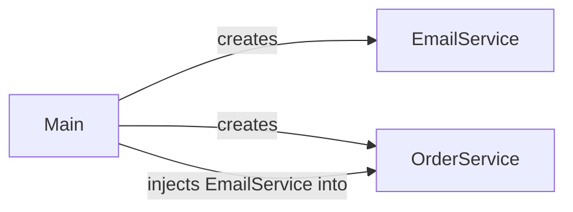
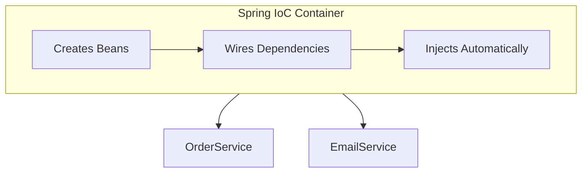

# Spring Core: Dependency Injection & Inversion of Control
### Last-minute interview cheat sheet

---

## 1. The Problem — Tightly Coupled Code

**Scenario:** `OrderService` places an order and sends a notification.

```java
class SimpleOrderService {
    public void placeOrder() {
        System.out.println("Order Placed");
        EmailService notification = new EmailService(); // <-- creates its OWN dependency
        notification.sendNotification();
    }
}

class EmailService {
    public void sendNotification() {
        System.out.println("Email notification sent");
    }
}
```

🔴 **Problem:** `OrderService` **creates** the `EmailService` object itself.
This is called **tight coupling** — nothing to do with Spring yet, just bad Java design.

---

## 2. Why Tight Coupling Is Bad

| Principle Violated | Why |
|---|---|
| **Single Responsibility Principle (SRP)** | `OrderService` should only manage orders — not *create* notification objects. It's acting like a factory too. |
| **Open/Closed Principle (OCP)** | To switch from Email → SMS, you must **open and edit** `OrderService`'s code instead of just extending it. |

> 💡 **Analogy used in video:** Going from Delhi → Chandigarh and insisting on a *specific bus, driver, and company* = tightly coupled. Just needing "a way to travel" = loosely coupled.

---

## 3. Step 1 (Partial Fix) — Code to Interfaces

Create a common interface so multiple notification types can be swapped:

```java
interface NotificationService {
    void sendNotification();
}

class EmailService implements NotificationService {
    public void sendNotification() { System.out.println("Email notification sent"); }
}

class SMSService implements NotificationService {
    public void sendNotification() { System.out.println("SMS notification sent"); }
}

class PopUpNotificationService implements NotificationService {
    public void sendNotification() { System.out.println("Pop-up notification sent"); }
}
```

⚠️ **Still broken:** Even using the interface as the variable type, the object is still created *concretely inside* `OrderService`:

```java
NotificationService notification = new EmailService(); // still tightly coupled!
```

**Key insight:** *Creating the object is not the problem — WHERE it's created is the problem.*

---

## 4. Step 2 (Real Fix) — Dependency Injection (DI)

> **Golden rule:** *"A class should ASK for what it needs, not BUILD it itself."*

Instead of `OrderService` creating its own `NotificationService`, it should **receive** one from outside.

### (a) Constructor Injection
```java
class OrderService {
    private NotificationService notification;

    public OrderService(NotificationService notification) {
        this.notification = notification;   // received, not created
    }

    public void placeOrder() {
        System.out.println("Order Placed");
        notification.sendNotification();
    }
}
```

```java
// main.java (acts as the "wiring" layer)
NotificationService notification = new EmailService();
OrderService order = new OrderService(notification);
order.placeOrder();
// Output: Order Placed → Email notification sent
```

Switching to SMS now needs **zero changes inside `OrderService`**:
```java
NotificationService notification = new SMSService();
OrderService order = new OrderService(notification);
```

### (b) Setter Injection
```java
class OrderService {
    private NotificationService notification;

    public OrderService() {}   // empty constructor

    public void setNotification(NotificationService notification) {
        this.notification = notification;
    }
}
```
```java
OrderService order = new OrderService();
order.setNotification(new EmailService());
```

### (c) Field Injection
- 3rd type, done via annotations (`@Autowired`) — **only possible with the Spring framework**, not plain Java.

---

## 5. Types of Dependency Injection (Quick Recall)

| Type | How | Notes |
|---|---|---|
| Constructor Injection | Passed via constructor | Most recommended (immutable, mandatory deps) |
| Setter Injection | Passed via setter method | Good for optional dependencies |
| Field Injection | Injected directly into field via annotation | Spring-only, less testable |

---

## 6. Benefits of DI

1. ✅ **Open/Closed Principle honored** — swap notification types without touching `OrderService`.
2. ✅ **Single Responsibility restored** — `OrderService` only manages orders; it doesn't build notification objects.
3. ✅ **Easier Unit Testing** — inject a *fake/mock* dependency instead of a real one:

```java
class FakeEmailService implements NotificationService {
    public void sendNotification() {
        System.out.println("Dummy email sent"); // no real email cost/side-effect
    }
}
```
```java
OrderService order = new OrderService(new FakeEmailService());
order.placeOrder(); // safe to test — no real email triggered
```

---

## 7. Inversion of Control (IoC)

**Definition:** The *direction of control* over object creation is flipped ("inverted").

### Before DI:

Control flows **Order Service → Email Service** (Order Service is in charge of creating its own dependency).

### After DI:

Control flows **Main → Order Service** (Order Service no longer creates anything — it just *receives*).

> 🔑 **That flip in direction of control (from "class creates its own dependency" → "something external provides it") is Inversion of Control.**

---

## 8. DI vs IoC — Relationship (Common Interview Trap!)

| Term | What it is |
|---|---|
| **IoC (Inversion of Control)** | A **principle/idea**: "don't let a class control its own dependency creation." |
| **Dependency Injection (DI)** | The **technique/method** used to *achieve* IoC. |

> 🎯 One-liner for interviews: **"IoC is the principle; DI is the technique that implements it."**

---

## 9. Where Spring Fits In

- In plain Java, **`main()` becomes the wiring layer** — manually creating and injecting every dependency.
- This doesn't scale: real projects have **hundreds/thousands of classes** with deep dependency trees (Service A → Service B → Service C...).
- **Spring's IoC Container** takes over this wiring job:
  - Creates objects (beans)
  - Manages their dependencies
  - Injects them automatically (via `@Autowired`, constructor injection, etc.)
- You stop manually wiring everything in `main()` — Spring's container does it for you "like magic."



---

## 10. Interview-Ready Summary (30-second answer)

> "Tightly coupled code has classes creating their own dependencies directly, which violates Single Responsibility and Open/Closed principles and makes unit testing hard. **Dependency Injection** solves this by having a class *receive* its dependencies (via constructor, setter, or field) instead of creating them. This causes **Inversion of Control** — the responsibility of creating and wiring dependencies moves from the class itself to an external source. In plain Java, that external source is often `main()`; in Spring, it's the **IoC Container**, which automatically creates, wires, and injects beans, removing the need for manual wiring."

---

### Quick Fire Q&A

- **Q: Is DI a Spring-only concept?**
  A: No — DI is a general OOP design pattern. Spring just automates it.

- **Q: What's the difference between tight and loose coupling?**
  A: Tight = class creates/depends on concrete implementations directly. Loose = class depends on abstractions (interfaces) and receives implementations externally.

- **Q: Name the 3 types of DI.**
  A: Constructor, Setter, Field injection.

- **Q: What design principles does DI help satisfy?**
  A: Single Responsibility Principle & Open/Closed Principle (both from SOLID).
