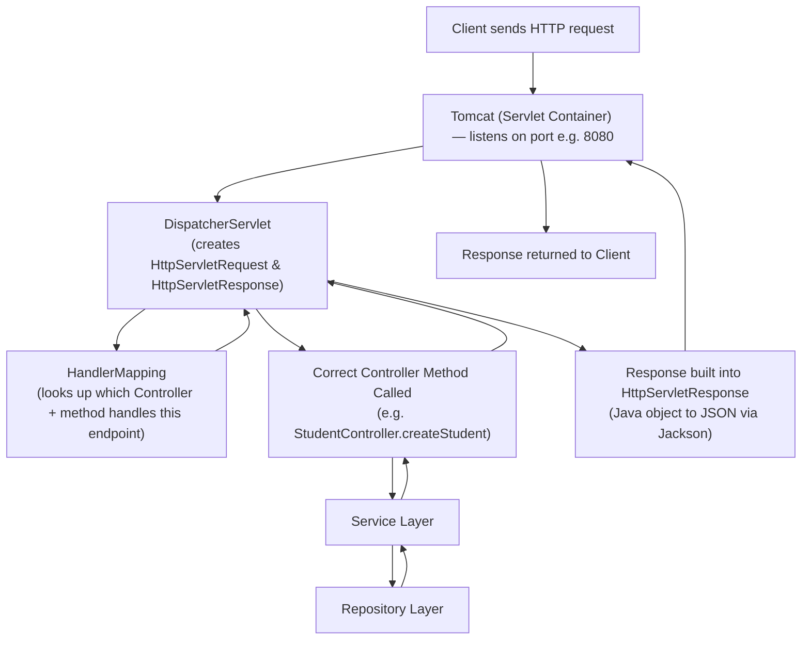

# Spring MVC: Internal Architecture (DispatcherServlet, Handler Mapping & Spring Boot Connection)
### Last-minute interview cheat sheet

> Note: all code blocks below use plain (unstyled) formatting so text stays readable in dark or light PDF export themes.

---

## 1. What is Spring MVC?

- Spring MVC (a.k.a. **Spring Web MVC**) is Spring's **official web framework**.
- Provides annotations/classes to build web apps: `@Controller`, `@RestController`, `@GetMapping`, `@PostMapping`, `@RequestBody`, etc.
- **MVC = Model – View – Controller**
  - **Controller** → handles HTTP requests (your endpoint methods).
  - **View** → what's returned to the browser (HTML, JSP pages) — used in traditional web apps.
  - **Model** → the data passed to the view.
- A **REST API** just returns data (usually JSON) instead of a "view" (HTML page).

> 🔑 **Spring Boot vs Spring MVC:** Spring Boot is NOT a separate web framework — it's an **auto-configuration layer on top of Spring MVC**. Everything Spring Boot does automatically (Tomcat setup, DispatcherServlet registration, JSON conversion), you'd otherwise configure manually using plain Spring MVC.

---

## 2. The Core Problem MVC Solves

Without a framework, a **servlet-based** app needs **one servlet per resource**:
```
Tomcat → UserServlet
Tomcat → OrderServlet
Tomcat → PaymentServlet
```
Each servlet repeats the same boilerplate:
- Parsing request parameters
- Converting JSON → Java object
- Building the response (status codes, JSON conversion)
- Exception handling

**Spring's fix:** Replace all these separate servlets with **ONE central servlet** — the **DispatcherServlet** — which does all that repetitive work centrally, then forwards the actual business logic call to lightweight **Controllers**.

```
Tomcat → DispatcherServlet → UserController
                           → OrderController
                           → PaymentController
```

---

## 3. Full Request Flow (Most Important Diagram)



### Step-by-step:
1. Client sends request → hits **Tomcat** (the servlet container listening on a port).
2. Tomcat wraps the request into `HttpServletRequest` / `HttpServletResponse` objects and passes them to the **DispatcherServlet** (Tomcat only talks to ONE servlet — the dispatcher).
3. DispatcherServlet asks **HandlerMapping** for the mapping table: *"which Controller + method handles `GET /students`?"*
4. HandlerMapping returns the matching method reference.
5. DispatcherServlet **calls that Controller method** directly.
6. Controller → Service → Repository → back up the chain, returning a response object.
7. DispatcherServlet converts the returned Java object → JSON (via **Jackson library**) and writes it into `HttpServletResponse`.
8. Tomcat sends the final HTTP response back to the client.

---

## 4. HandlerMapping — How the Mapping Table is Built

- Spring's **IoC container** creates all beans first (Controllers, Services, Repositories — same as Spring Core).
- `HandlerMapping` then **scans all Controller beans** for annotations like `@GetMapping`, `@PostMapping`, `@PutMapping`, `@DeleteMapping`.
- It builds an internal lookup table, e.g.:
```
GET  /students        -> StudentController.getAllStudents
POST /students        -> StudentController.createStudent
GET  /students/{id}   -> StudentController.getStudent
```
- DispatcherServlet uses this table to invoke the correct method for every incoming request.

---

## 5. How Different Request Data Gets Mapped

| Data source | Example | Who resolves it |
|---|---|---|
| **Request Body** (JSON) | `{"id":1,"name":"Aditya"}` → mapped via `@RequestBody` | DispatcherServlet uses **Jackson** to convert JSON → Java object |
| **Path Variable** | `/students/1` → `@PathVariable Long id` | HandlerMapping's internal **HandlerMethodArgumentResolver** |
| **Query Parameter** | `/students?id=1` → `@RequestParam` | **Tomcat** itself already parses these into the request object |

---

## 6. Building a Manual Spring MVC App (What Spring Boot Hides From You)

### Dependencies needed manually (Spring Boot gives these for free via `spring-boot-starter-web`):
```
spring-webmvc        -> gives annotations (@Controller, @GetMapping, etc.)
tomcat-embed-core    -> embedded Tomcat server
jackson-databind     -> JSON <-> Java object conversion
```

### Typical layers (identical structure to Spring Boot apps):
```
Entity      -> Student.java (plain POJO)
Repository  -> @Repository StudentRepository (using a HashMap here, mimicking a DB)
Service     -> @Service StudentService (constructor-injects Repository)
Controller  -> @RestController StudentController (constructor-injects Service)
```

### Example Controller:
```
@RestController
@RequestMapping("/students")
class StudentController {

    private final StudentService studentService;

    public StudentController(StudentService studentService) {
        this.studentService = studentService;
    }

    @PostMapping
    public ResponseEntity<Student> createStudent(@RequestBody Student studentRequest) {
        Student response = studentService.createStudent(studentRequest);
        return ResponseEntity.ok(response);
    }

    @GetMapping("/{id}")
    public ResponseEntity<Student> getStudent(@PathVariable Long id) {
        Student response = studentService.getStudent(id);
        if (response == null) {
            return ResponseEntity.notFound().build();
        }
        return ResponseEntity.ok(response);
    }
}
```

### Configuration class (replaces Spring Boot's auto-config):
```
@Configuration
@ComponentScan(basePackages = "in.strikes")
@EnableWebMvc
class WebConfig {
}
```
- `@EnableWebMvc` → activates MVC-specific annotations (`@RequestBody`, `@GetMapping`, etc.) — Spring Boot does this automatically internally.

### Manual boilerplate in `main()` (all of this is automatic in Spring Boot!):
```
Tomcat tomcat = new Tomcat();
tomcat.setPort(8080);
tomcat.getConnector();

String contextPath = "";
String baseDir = new File("src/main/webapp").getAbsolutePath();
Context context = tomcat.addContext(contextPath, baseDir);

AnnotationConfigWebApplicationContext springContext = new AnnotationConfigWebApplicationContext();
springContext.register(WebConfig.class);

DispatcherServlet dispatcherServlet = new DispatcherServlet(springContext);

Tomcat.addServlet(context, "dispatcherServlet", dispatcherServlet);
context.addServletMappingDecoded("/", "dispatcherServlet");

tomcat.start();
tomcat.getServer().await();
```

> 🎯 **Interview line:** *"Spring Boot's `@EnableAutoConfiguration` essentially auto-generates and runs this exact boilerplate for you — creating the embedded Tomcat, registering the IoC container, wiring the DispatcherServlet, and mapping it — the moment you add `spring-boot-starter-web`."*

---

## 7. `@Controller` vs `@RestController`

| Annotation | Behavior |
|---|---|
| `@Controller` | Returns a **view** (HTML/JSP) by default. To return raw data (JSON) from a method, you must add `@ResponseBody` on that method. |
| `@RestController` | = `@Controller` + `@ResponseBody` **applied automatically** to all methods. Used for REST APIs. |

```
@Controller
class StudentController {
    @PostMapping("/students")
    @ResponseBody   // needed here manually
    public ResponseEntity<Student> createStudent(...) { ... }
}

// vs.

@RestController   // @ResponseBody is implicit for every method
class StudentController {
    @PostMapping("/students")
    public ResponseEntity<Student> createStudent(...) { ... }
}
```

---

## 8. Embedded vs External Tomcat

| | External Tomcat | Embedded Tomcat |
|---|---|---|
| Setup | Download Tomcat separately, package app as a `.war`, deploy into Tomcat's `webapps/` folder | Tomcat runs **inside** your application (as a dependency) |
| Used by | Legacy/traditional deployments | Spring Boot (default) |
| Build output | `.war` file | Runnable `.jar` (Tomcat starts when your app starts) |

> Multiple web apps can be deployed inside one external Tomcat, each under its own **context path** (e.g. `/app1`, `/app2`). With embedded Tomcat, context path is typically left empty (`""`) since there's only one app.

---

## 9. Interview-Ready Summary (30-second answer)

> "Spring MVC follows the Model-View-Controller pattern and is Spring's official web framework, providing annotations like `@Controller`, `@GetMapping`, etc. Internally, Tomcat (the servlet container) forwards every incoming request to a single central servlet — the **DispatcherServlet** — instead of having separate servlets per resource. The DispatcherServlet consults **HandlerMapping**, which has scanned all Controller beans in the IoC container for mapping annotations, to figure out which controller method should handle the request. It also handles cross-cutting concerns like JSON-to-Java conversion (via Jackson) and building the HTTP response. Spring Boot doesn't change any of this — it just **auto-configures** the embedded Tomcat setup, DispatcherServlet registration, and IoC container wiring that you'd otherwise have to write by hand in plain Spring MVC."

---

### Quick Fire Q&A

- **Q: What does DispatcherServlet do?**
  A: Acts as the single front-controller servlet that Tomcat forwards all requests to; it uses HandlerMapping to find the right controller method, invokes it, and converts the result to/from JSON.

- **Q: What is HandlerMapping?**
  A: A component that builds a lookup table of endpoint → controller method by scanning `@GetMapping`/`@PostMapping`/etc. annotations on controller beans in the IoC container.

- **Q: Who resolves query parameters vs path variables vs request body?**
  A: Query params → Tomcat itself. Path variables → HandlerMapping's argument resolver. Request body → DispatcherServlet using Jackson.

- **Q: Difference between `@Controller` and `@RestController`?**
  A: `@RestController` = `@Controller` + `@ResponseBody` auto-applied to every method, so return values are written directly as the response body (e.g. JSON) instead of resolved as a view name.

- **Q: What does M-V-C stand for and what does "View" mean in Spring MVC?**
  A: Model-View-Controller. "View" = an HTML or JSP page rendered and returned to the browser — used in traditional (non-REST) web apps.

- **Q: Is Spring Boot a different framework than Spring MVC?**
  A: No — Spring Boot sits on top of Spring MVC and auto-configures the setup (embedded Tomcat, DispatcherServlet, IoC container) that you'd otherwise configure manually.
