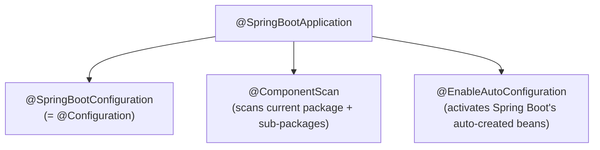
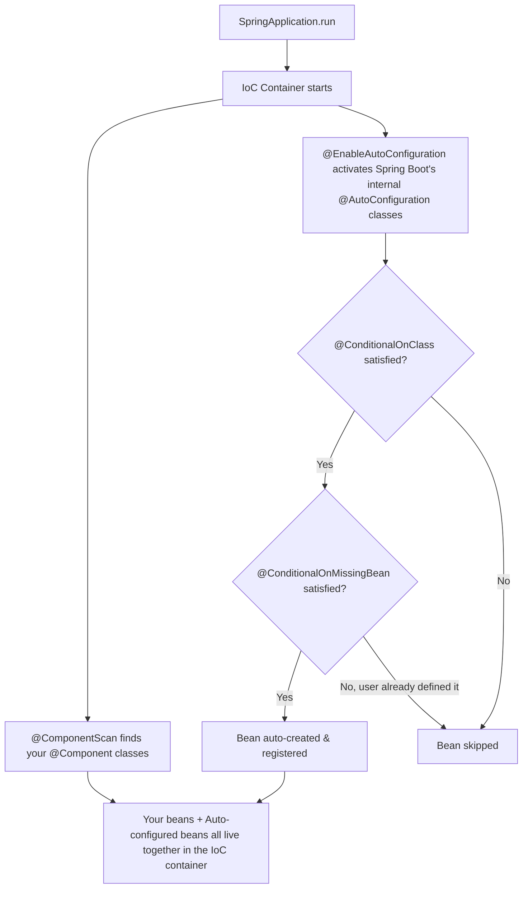

# Spring Boot: Auto-Configuration & IoC Container
### Last-minute interview cheat sheet

---

## 1. Spring Core vs Spring Boot — The Big Picture

| | Spring Core | Spring Boot |
|---|---|---|
| IoC container setup | Manual: `new AnnotationConfigApplicationContext(AppConfig.class)` | Automatic: `SpringApplication.run(...)` |
| Configuration class | You create your own (`@Configuration` + `@ComponentScan`) | Auto-generated via `@SpringBootApplication` |
| Bean creation for standard/3rd-party classes | You must manually write `@Bean` methods | Spring Boot auto-creates many beans for you (**auto-configuration**) |
| Dependency needed | `spring-context` | `spring-boot-starter` (+ `spring-boot-starter-parent` in POM) |

> 🔑 **Core idea:** Spring Boot doesn't introduce new concepts — it **automates** everything you were doing manually in Spring Core.

---

## 2. Minimal Setup Differences

**Spring Core `pom.xml`:**
```xml
<dependency>
    <groupId>org.springframework</groupId>
    <artifactId>spring-context</artifactId>
    
</dependency>
```

**Spring Boot `pom.xml`:**
```xml
<dependency>
    <groupId>org.springframework.boot</groupId>
    <artifactId>spring-boot-starter</artifactId>
</dependency>
```

### The `<parent>` Tag (Important!)
```xml
<parent>
    <groupId>org.springframework.boot</groupId>
    <artifactId>spring-boot-starter-parent</artifactId>
</parent>
```
- Solves **dependency version conflicts** — you don't need to specify a `<version>` for Spring Boot dependencies; the parent POM already knows which versions are mutually compatible.
- Generated automatically when you use **Spring Initializr**.

---

## 3. Starting the Application — `SpringApplication.run()`

```java
@SpringBootApplication
public class MyApp {
    public static void main(String[] args) {
        SpringApplication.run(MyApp.class, args);
    }
}
```
- `SpringApplication.run()` returns a `ConfigurableApplicationContext` (which **extends** `ApplicationContext`).
- This means the IoC container **is already up** — you never manually wrote `new AnnotationConfigApplicationContext(...)`.
```java
ApplicationContext context = SpringApplication.run(MyApp.class, args); // optional capture
```
> ⚠️ Best practice: **avoid** calling `context.getBean(...)` manually in Spring Boot — that's the Spring-Core way. (Better alternatives covered in next lecture — e.g. `CommandLineRunner`.)

---

## 4. `@SpringBootApplication` = 3 Annotations in One

```java
@SpringBootApplication
// is equivalent to writing all 3 below:
@SpringBootConfiguration
@EnableAutoConfiguration
@ComponentScan
```



---

## 5. Annotation 1 — `@SpringBootConfiguration`
- Functionally identical to plain `@Configuration` from Spring Core.
- Since it sits on your **main class**, your main class itself becomes a configuration file.
- **You can write `@Bean` methods directly inside your main class:**
```java
@SpringBootApplication
public class MyApp {
    public static void main(String[] args) {
        SpringApplication.run(MyApp.class, args);
    }

    @Bean
    public UserService userService() {
        return new UserService();
    }
}
```

---

## 6. Annotation 2 — `@ComponentScan` (Convention over Configuration)

- No package name needed — Spring Boot scans the **package containing the main class, and all its sub-packages**.
- ⚠️ Classes placed **outside** that package (e.g., a sibling package) will **NOT** be picked up.
- Can override with:
```java
@SpringBootApplication(scanBasePackages = "in.strikes")
```
> 🔑 Interview line: *"Spring Boot is an opinionated framework — follow its folder convention and component scanning works automatically."*

---

## 7. Annotation 3 — `@EnableAutoConfiguration` (The Real Magic)

**One-line definition:** *"Look at my project's dependencies, and automatically create whatever beans make sense — without me writing `@Component` or `@Bean` myself."*

### Recall — Only 2 manual ways existed in Spring Core to register beans:
1. `@Component` on a class
2. `@Bean` inside a `@Configuration` class

### Spring Boot adds a 3rd, automatic way:
3. `@AutoConfiguration` classes — **written internally by Spring Boot itself** (or by 3rd-party library authors), each containing pre-built `@Bean` methods.

```java
@AutoConfiguration
public class WebAutoConfiguration {

    @Bean
    public WebClassA webClassA() {
        return new WebClassA();
    }
}
```
- These classes are **not written by you** — they ship inside Spring Boot's starter jars.
- `@EnableAutoConfiguration` is what tells Spring Boot: *"go activate all these pre-written `@AutoConfiguration` classes."*

---

## 8. Why Auto-Configuration Exists (Real Example)

- You add a **3rd-party jar** (e.g., `spring-boot-starter-web`) → it brings compiled `.class` files (like a `JSONParser` interface + implementations).
- You **can't** put `@Component` on read-only/compiled classes.
- Normally you'd have to manually write:
```java
@Bean
public JSONParser jsonParser() {
    return new BasicJSONParser();
}
```
- Instead, Spring Boot **already includes** an internal `@AutoConfiguration` class that defines this bean for you — so it "just works" the moment you add the dependency.

### Proof via demo:
```text
No web dependency  → app runs, NO Tomcat starts.
Add spring-boot-starter-web → rerun app → Tomcat starts automatically on port 8080!
```
No code changes needed — just adding the dependency triggered Spring Boot's built-in auto-configuration for the web server.

---

## 9. Conditional Annotations (Used Inside Auto-Configuration Classes)

| Annotation | Meaning |
|---|---|
| `@ConditionalOnClass(WebClassA.class)` | Only create this bean **if that specific class/dependency exists** on the classpath |
| `@ConditionalOnMissingBean` | Only create this bean **if the user hasn't already defined their own** version of it |

```java
@AutoConfiguration
public class WebAutoConfiguration {

    @Bean
    @ConditionalOnClass(WebClassA.class)
    @ConditionalOnMissingBean
    public WebClassA webClassA() {
        return new WebClassA();
    }
}
```

> 🎯 **Interview gold:** *"`@ConditionalOnClass` checks the dependency exists; `@ConditionalOnMissingBean` avoids overriding a bean the developer already defined manually — Spring Boot's autoconfig always yields to user-defined beans."*

---

## 10. Full Bean-Creation Flow in Spring Boot



---

## 11. 3rd-Party Libraries Can Ship Their Own Auto-Configuration

- If **you** build a library (e.g., a payment gateway SDK) and want consumers' Spring Boot apps to auto-register your beans, you write your own `@AutoConfiguration` class inside your jar.
- Any Spring Boot app that adds your jar as a dependency will automatically pick it up — no manual config needed by the consumer.

---

## 12. Interview-Ready Summary (30-second answer)

> "Spring Boot doesn't replace Spring Core's IoC concepts — it automates them. `SpringApplication.run()` starts the IoC container for you. The `@SpringBootApplication` annotation bundles three things: `@SpringBootConfiguration` (marks the main class as a config class, so you can write `@Bean` methods right there), `@ComponentScan` (auto-scans the main class's package and sub-packages by convention), and `@EnableAutoConfiguration` — the key feature — which activates internal `@AutoConfiguration` classes shipped by Spring Boot (or third-party starters) that pre-define beans for common needs like Tomcat, Jackson, JDBC, etc. These auto-configured beans are conditionally created using `@ConditionalOnClass` (only if the needed dependency is present) and `@ConditionalOnMissingBean` (only if the developer hasn't already defined that bean themselves)."*

---

### Quick Fire Q&A

- **Q: What are the 3 annotations bundled inside `@SpringBootApplication`?**
  A: `@SpringBootConfiguration`, `@ComponentScan`, `@EnableAutoConfiguration`.

- **Q: How does Spring Boot know which package to scan if no package name is given?**
  A: By convention — it scans the package containing the main class (and sub-packages).

- **Q: What problem does `spring-boot-starter-parent` solve?**
  A: Dependency version compatibility — you don't need to manually specify/match versions for Spring Boot-related dependencies.

- **Q: What's the difference between `@Component`/`@Bean` and `@AutoConfiguration`?**
  A: `@Component`/`@Bean` are manual, developer-written ways to register beans. `@AutoConfiguration` classes are pre-written (by Spring Boot or library authors) and activated automatically via `@EnableAutoConfiguration`.

- **Q: What does `@ConditionalOnMissingBean` protect against?**
  A: Overriding a bean the developer has already manually defined — auto-config always defers to user-defined beans.

- **Q: Does adding `spring-boot-starter-web` require you to configure Tomcat manually?**
  A: No — auto-configuration detects the dependency (`@ConditionalOnClass`) and automatically registers and starts an embedded Tomcat server bean.

- **Q: Is Spring Boot only for web applications?**
  A: No — Spring Boot can build plain console/core applications too; web capability only comes in if you add `spring-boot-starter-web`.
