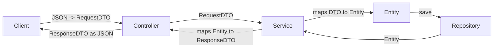

# Spring Boot: DTOs & Validation
### Last-minute interview cheat sheet

---

## 1. The Problem — Using Entity Directly for Request/Response

Without DTOs, the flow looks like this:


The **same Entity class** is used for: receiving the request, business logic, database mapping, **and** sending the response.

### Why this is a bad practice:
1. **Security risk** — client can send fields they shouldn't control (e.g. `deleted`, `createdAt`, `updatedAt`, internal flags), and if you forget to override them, they get saved as-is.
2. **Over-exposure** — the full entity (including sensitive/internal fields like `deleted`) gets sent back to the client in the response, leaking internal implementation details.
3. **Tight coupling between internal & external worlds** — if you change the database schema (e.g. split `name` into `firstName`/`lastName`), you **break the client's API contract** too, since the entity *is* the contract.

> 🔑 **Core principle:** *Entity = internal world (maps to DB table). DTO = external world (the contract with the client).* These should be decoupled.

---

## 2. What is a DTO?

**DTO = Data Transfer Object.**
- Just a plain Java POJO (fields + getters/setters) — **no database annotations**.
- Represents *exactly* the shape of data going in (**Request DTO**) or out (**Response DTO**) of your API — not necessarily the same shape as the Entity.



### Key benefits:
| Problem Solved | How |
|---|---|
| Client sending sensitive/internal fields | RequestDTO only exposes the fields you explicitly allow (e.g. no `deleted`, no `createdAt`) |
| Leaking internal fields to client | ResponseDTO only returns what you choose to expose (can even add extra fields like a custom `message`) |
| Schema changes breaking the client | Entity can change freely — DTO stays the stable public contract |

### Common Pattern — Separate DTOs per operation:
- `CreateStudentRequestDTO` / `CreateStudentResponseDTO`
- `UpdateStudentRequestDTO` / `UpdateStudentResponseDTO`
- (Update DTO may intentionally exclude fields like `email` if that field shouldn't be editable after creation.)

> 🎯 **Interview line:** *"A DTO decouples your API contract from your database schema — the entity handles persistence, the DTO handles what's exposed to the client. Mapping between them (Entity ↔ DTO) typically happens in the service layer, or in dedicated Mapper classes as the project grows."*

---

## 3. Bean Validation — Validating the Request DTO

**Why validate at the DTO level (not in the Service layer)?**
- Client input mistakes (blank name, invalid email, underage value) are **basic data-integrity checks**, not business logic.
- Service layer should stay focused on business logic — invalid requests should be rejected **before** they even reach it.

### Setup
- Dependency: `spring-boot-starter-validation` (like other starters, Spring Boot manages its version via `spring-boot-starter-parent` — no version number needed).

### How it works
1. Add validation annotations on the **RequestDTO fields**.
2. Add `@Valid` on the `@RequestBody` parameter in the **Controller**.
3. If validation fails → Spring Boot automatically returns **HTTP 400 Bad Request** (default generic response, unless you add custom exception handling).

```java
class CreateStudentRequestDTO {

    @NotBlank(message = "Student name cannot be blank")
    @Size(min = 2, max = 50, message = "Name must be within 2 to 50 characters")
    private String name;

    @NotNull(message = "Age is required")
    @Min(value = 18, message = "Student must be at least 18 years old")
    private Integer age;

    @NotBlank(message = "Student email cannot be blank")
    @Email(message = "Student email must be valid")
    private String email;

    @NotNull(message = "Roll number is required")
    private Integer rollNumber;

    @NotBlank(message = "Subject is required")
    private String subject;
}
```

```java
@PostMapping
public ResponseEntity<CreateStudentResponseDTO> createStudent(@Valid @RequestBody CreateStudentRequestDTO request) {
    ...
}
```

### Common Validation Annotations

| Annotation | Meaning |
|---|---|
| `@NotNull` | Value cannot be `null` (but can be empty/blank) |
| `@NotEmpty` | Cannot be `null` or empty (`""`), but blank spaces `"   "` allowed |
| `@NotBlank` | Cannot be `null`, empty, **or** just whitespace — strictest, preferred for Strings |
| `@Size(min=, max=)` | String/collection length must fall within range |
| `@Min` / `@Max` | Numeric value must be ≥ / ≤ given value |
| `@Email` | Must match valid email format |
| `@Positive` | Value must be positive |
| `@Past` / `@Future` | Date/time must be in the past/future |

> 💡 **Interview tip:** For String fields, prefer `@NotBlank` over `@NotNull`/`@NotEmpty` since it's the strictest (catches null, empty, and whitespace-only values in one annotation).

### ⚠️ Without `@Valid`, validation annotations do nothing!
`@Valid` is what actually **triggers** the validation checks on the incoming object — annotations alone are inert without it.

---

## 4. Interview-Ready Summary (30-second answer)

> "Using the Entity class directly for both request and response ties your API contract to your database schema and risks exposing or accepting sensitive fields. A **DTO (Data Transfer Object)** is a plain POJO that defines exactly what shape of data comes in (RequestDTO) or goes out (ResponseDTO) of an endpoint, decoupling the internal persistence model from the external API contract — mapping between Entity and DTO happens in the service layer. On top of DTOs, **Bean Validation** annotations (`@NotBlank`, `@Email`, `@Min`, etc.) placed on the RequestDTO fields, combined with `@Valid` on the controller's `@RequestBody` parameter, let Spring Boot automatically reject malformed client input with a 400 Bad Request — keeping basic data-integrity checks out of the service/business-logic layer."

---

### Quick Fire Q&A

- **Q: Why not just return the Entity directly from the controller?**
  A: It exposes internal/sensitive fields (like soft-delete flags, timestamps) and tightly couples your DB schema to the client contract.

- **Q: Where does Entity ↔ DTO mapping usually happen?**
  A: In the Service layer initially; as the project grows, it's moved into dedicated Mapper classes.

- **Q: What's the difference between `@NotNull`, `@NotEmpty`, and `@NotBlank`?**
  A: `@NotNull` blocks null only; `@NotEmpty` blocks null + empty string; `@NotBlank` blocks null + empty + whitespace-only (strictest).

- **Q: What happens if you add validation annotations but forget `@Valid`?**
  A: Nothing — validations are never triggered without `@Valid` on the controller parameter.

- **Q: Why have separate Create/Update DTOs instead of one generic DTO?**
  A: Different operations may allow/require different fields (e.g., Update DTO might exclude `email` if it shouldn't be changeable after creation).
