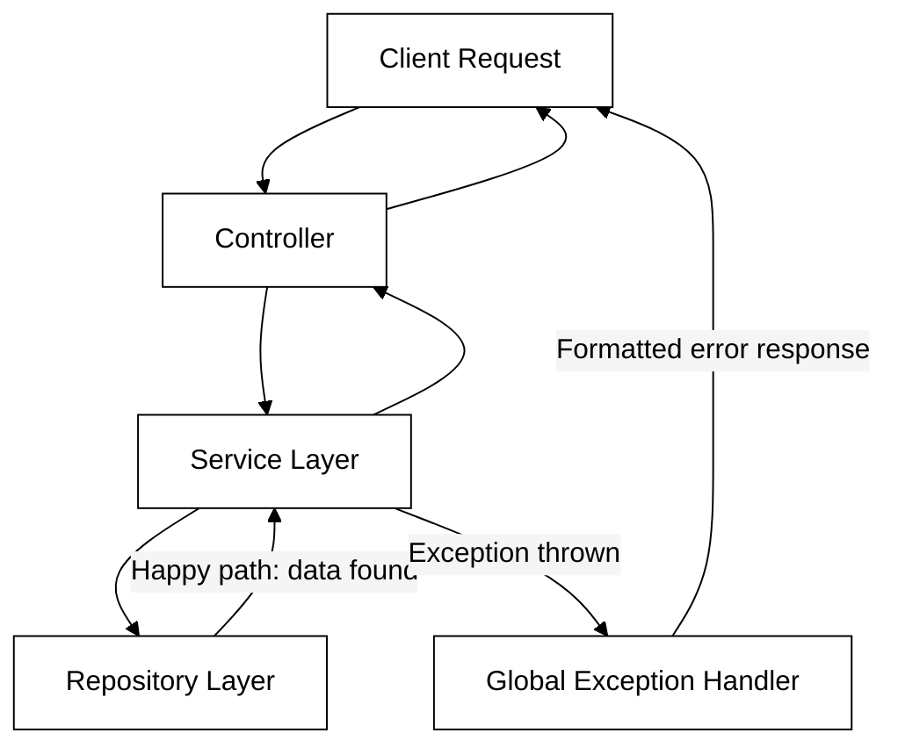

# Spring Boot: Exception Handling
### Last-minute interview cheat sheet

---

## 1. Anatomy of an API Response

Every API response has 3 parts:

| Part | Meaning |
|---|---|
| **Status Code** | The actual meaning/outcome of the response (success, failure, etc.) — the most important part |
| **Headers** | Key-value metadata for the client |
| **Body** | The actual data (usually JSON) |

> 🔑 **Interview line:** *"What separates a beginner API from a professional one is mostly how carefully status codes, headers, and error bodies are handled — not just whether the business logic works."*

### Common beginner mistake:
Returning `200 OK` for **every** case — even when data isn't found, or something failed — instead of picking the status code that matches what actually happened.

---

## 2. HTTP Status Code Families

| Family | Meaning |
|---|---|
| 1xx | Informational |
| 2xx | Success |
| 3xx | Redirection |
| 4xx | Client-side error (bad request, not found, etc.) |
| 5xx | Server-side error |

### Most commonly used codes:

| Code | Meaning | When to use |
|---|---|---|
| 200 OK | Success | Normal successful GET/PUT etc. |
| 201 Created | Resource created | After a successful POST |
| 204 No Content | Success, nothing to return | After a successful DELETE |
| 400 Bad Request | Client sent invalid data | Validation failures, malformed input |
| 404 Not Found | Resource doesn't exist | GET/PUT/DELETE on missing ID |
| 409 Conflict | Conflicting state | e.g., duplicate email on create |
| 500 Internal Server Error | Unknown/generic server-side failure | Bugs, DB down, unhandled exceptions |

> 💡 `204 No Content` (success) vs `404 Not Found` (client error) — easy to confuse but opposite meanings: 204 = "done, nothing to show"; 404 = "couldn't even find what you asked for."

---

## 3. The Problem — Controller Doing Too Much

Without proper exception handling, controllers end up full of `if/else` checks:
```
public ResponseEntity<Student> getStudent(Long id) {
    Student response = studentService.getStudent(id);
    if (response == null) {
        return ResponseEntity.notFound().build();
    }
    return ResponseEntity.ok(response);
}
```

**Why this is bad:**
- Controller's job should be fixed: *receive request → delegate to service → return service's response.*
- Handling "what if data is null / list is empty / duplicate found" is **edge-case/exception logic**, not the controller's core responsibility.
- Leads to repeated, ugly `if/else` blocks across every method, in every controller.

### Spring Boot's Default Behavior (when you don't handle exceptions)
- If an exception is thrown and nothing catches it, Spring Boot auto-generates a **generic 500 response**:
```
{
  "timestamp": "...",
  "status": 500,
  "error": "Internal Server Error",
  "path": "/api/students/100"
}
```
- Internally, Spring Boot **reroutes unhandled exceptions to a special `/error` endpoint**, which builds this response (JSON for API clients, HTML "Whitelabel Error Page" for browsers).
- To see the actual internal exception message (for local debugging only — never in production):
```
spring.web.error.include-message=always
```

**Why relying on default handling is bad:** It's too generic — always 500, with minimal detail. Doesn't tell the client *what* went wrong (e.g., which field failed validation, which ID wasn't found).

---

## 4. The Solution — Centralized Exception Handling Flow



- **Happy path** stays in Controller → Service → Repository, exactly as normal.
- **Exception path** bypasses the Controller entirely and is caught by a **centralized handler class**.
- Benefits:
  1. Controller stays simple — only one responsibility.
  2. Error responses become **consistent** across the entire application (same JSON shape every time).

---

## 5. Building the Global Exception Handler

```
@RestControllerAdvice
public class GlobalExceptionHandler {

    @ExceptionHandler(ResourceNotFoundException.class)
    public ResponseEntity<ExceptionResponseDTO> handleResourceNotFoundException(ResourceNotFoundException ex, HttpServletRequest request) {
        ExceptionResponseDTO response = new ExceptionResponseDTO(
            LocalDateTime.now(),
            HttpStatus.NOT_FOUND.value(),
            HttpStatus.NOT_FOUND.getReasonPhrase(),
            ex.getMessage(),
            request.getRequestURI()
        );
        return ResponseEntity.status(HttpStatus.NOT_FOUND).body(response);
    }
}
```

### Key annotations:

| Annotation | Purpose |
|---|---|
| `@RestControllerAdvice` | Marks this class as a **helper/advice class for all Controllers** — common cross-cutting logic (like exception handling) written here applies globally. `= @ControllerAdvice + @ResponseBody` (returns JSON, not a view). Use plain `@ControllerAdvice` if returning views/HTML. |
| `@ExceptionHandler(SomeException.class)` | Marks a method as the handler for a **specific exception type** — think of it like a `catch` block, but centralized and global. |

### How resolution works (like a catch hierarchy):
- Spring Boot picks the **most specific matching handler** for the thrown exception — annotation *order in the file doesn't matter*.
- Common pattern: write handlers from most-specific → least-specific, with a final **catch-all** for the generic `Exception` class as a safety net:
```
@ExceptionHandler(Exception.class)
public ResponseEntity<ExceptionResponseDTO> handleGenericException(Exception ex, HttpServletRequest request) {
    // last-resort fallback — generic 500 response
}
```

---

## 6. Custom Exceptions

Since exceptions like `ResourceNotFoundException` or `DuplicateResourceException` **don't exist in Java by default**, you create them yourself:

```
public class ResourceNotFoundException extends RuntimeException {
    public ResourceNotFoundException(String message) {
        super(message);
    }
}
```
- Extends `RuntimeException` so it's unchecked (no forced try/catch everywhere).
- Acts purely as a **marker class** — no extra logic needed, just passes the message up to the parent.

### Usage in Service layer (clean, no more null-checks/if-else):
```
Student student = studentRepository.findById(id)
    .orElseThrow(() -> new ResourceNotFoundException("Student with ID " + id + " not found"));
```
- `findById(...).orElseThrow(...)` replaces manual `Optional` null-checking entirely.
- If not found → exception thrown → automatically routed to `GlobalExceptionHandler` (never touches the controller).
- If found → normal flow continues, mapped to DTO, returned to controller.

### Example — Duplicate check (409 Conflict):
```
if (existsByEmail(student.getEmail())) {
    throw new DuplicateResourceException("Student with email " + student.getEmail() + " already exists");
}
```

> 🎯 **Interview line:** *"Custom unchecked exceptions let the service layer clearly express business rule violations (`not found`, `duplicate`, etc.) without polluting the controller with conditional logic — the global handler translates each exception type into the correct HTTP status and response body."*

---

## 7. Consistent Error Response Shape — `ExceptionResponseDTO`

Instead of returning a plain `String` or ad-hoc message, define a **standard error DTO** (mirrors Spring Boot's own default error shape):

```
public class ExceptionResponseDTO {
    private LocalDateTime timestamp;
    private int status;
    private String error;
    private String message;
    private String path;
    // constructor, getters, setters
}
```

- `path` is obtained from the `HttpServletRequest` object (injected as a handler method parameter) via `request.getRequestURI()`.
- Every exception handler builds and returns this same DTO shape — only the values differ (status code, message).

> 🔑 **Why this matters:** A professional API always returns errors in the *same consistent format*, regardless of which exception occurred.

---

## 8. Handling Validation Errors — `MethodArgumentNotValidException`

When `@Valid` fails on a `@RequestBody` DTO, Spring Boot internally throws `MethodArgumentNotValidException` — **a specific, existing exception type** you can catch just like any other.

### Extended DTO for validation errors (includes a map of field-level errors):
```
public class ValidationExceptionResponseDTO extends ExceptionResponseDTO {
    private Map<String, String> fieldErrors;
    // constructor, getters, setters
}
```

### Handler:
```
@ExceptionHandler(MethodArgumentNotValidException.class)
public ResponseEntity<ValidationExceptionResponseDTO> handleValidationException(MethodArgumentNotValidException ex, HttpServletRequest request) {

    Map<String, String> fieldErrors = new HashMap<>();
    ex.getBindingResult().getFieldErrors().forEach(error ->
        fieldErrors.put(error.getField(), error.getDefaultMessage())
    );

    ValidationExceptionResponseDTO response = new ValidationExceptionResponseDTO(
        LocalDateTime.now(),
        HttpStatus.BAD_REQUEST.value(),
        HttpStatus.BAD_REQUEST.getReasonPhrase(),
        "Validation failed",
        request.getRequestURI(),
        fieldErrors
    );
    return ResponseEntity.badRequest().body(response);
}
```
- `ex.getBindingResult().getFieldErrors()` → list of every failed field, each with its field name + the `message` you defined in the `@NotBlank(message = "...")` style annotations.
- Result: client gets a clean, structured list of exactly which fields failed and why — instead of one giant generic message.

---

## 9. Full Before/After Summary

| Layer | Before (messy) | After (clean) |
|---|---|---|
| Controller | Full of `if (response == null) return notFound()` checks | `return studentService.getStudentById(id);` — one line |
| Service | Returns `null` or `Optional`, lets controller decide | Throws custom exceptions (`ResourceNotFoundException`, `DuplicateResourceException`) directly |
| Error responses | Inconsistent strings/messages, or Spring Boot's generic 500 | Consistent `ExceptionResponseDTO` shape, correct status code per error type |

---

## 10. Interview-Ready Summary (30-second answer)

> "Spring Boot has default exception handling that returns a generic 500 response with a timestamp, status, error, and path — but it's too generic for professional APIs. The better approach is a centralized `@RestControllerAdvice` class with `@ExceptionHandler` methods for each exception type, acting like a global catch block. Custom unchecked exceptions (extending `RuntimeException`) let the service layer express specific failures like 'not found' or 'duplicate' cleanly, using patterns like `findById(...).orElseThrow(...)`, instead of the controller doing manual null-checks. Every handler returns a consistent `ExceptionResponseDTO` (timestamp, status, error, message, path) so error responses look the same everywhere, and Spring's `MethodArgumentNotValidException` lets you return field-specific validation error messages instead of Spring Boot's generic 400 response."

---

### Quick Fire Q&A

- **Q: What's the difference between `@ControllerAdvice` and `@RestControllerAdvice`?**
  A: `@RestControllerAdvice` = `@ControllerAdvice` + `@ResponseBody` — returns JSON directly. Use `@ControllerAdvice` for apps that return views/HTML.

- **Q: What does `@ExceptionHandler` do?**
  A: Marks a method to handle a specific exception type thrown anywhere the advice class covers — like a global, centralized `catch` block.

- **Q: Which handler gets called if multiple `@ExceptionHandler` methods could match?**
  A: Spring Boot picks the most specific matching exception type — the order you write the methods in the file doesn't matter.

- **Q: Why extend `RuntimeException` for custom exceptions instead of `Exception`?**
  A: `RuntimeException` is unchecked, so you don't need to declare/catch it everywhere it's thrown — it can propagate cleanly up to the global handler.

- **Q: What HTTP status should a duplicate resource (e.g., email already exists) return?**
  A: `409 Conflict`.

- **Q: What exception does Spring Boot throw when `@Valid` fails?**
  A: `MethodArgumentNotValidException` — contains a `BindingResult` with per-field validation errors.

- **Q: Why shouldn't the controller contain `if (student == null) return notFound()` logic?**
  A: That's exception/edge-case handling, not the controller's core responsibility — it belongs in a centralized exception handler, keeping the controller focused only on delegating requests and returning responses.
