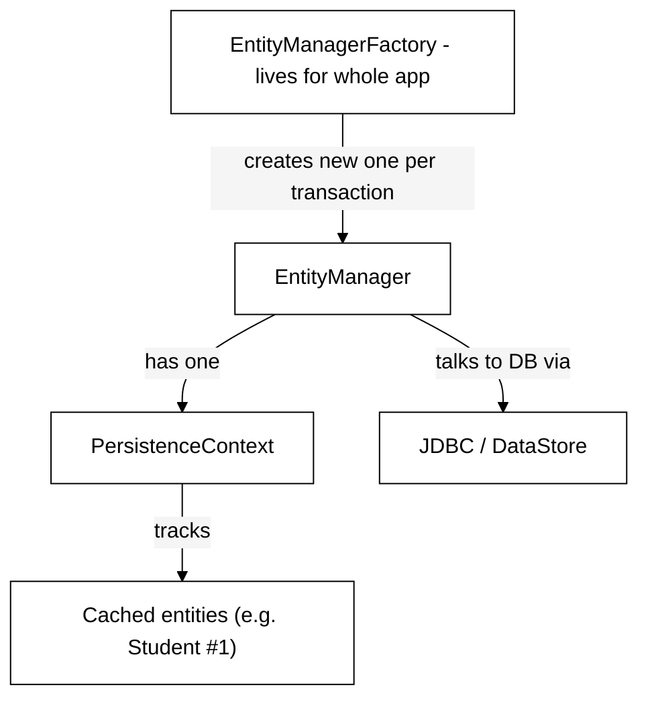
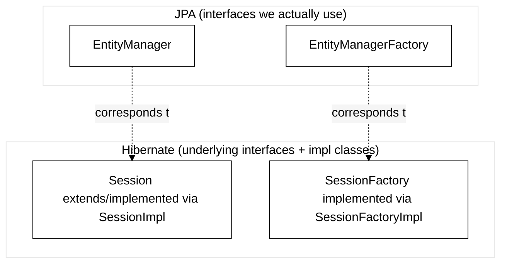
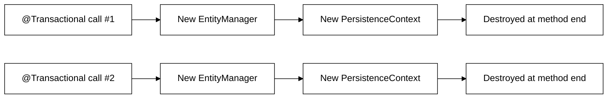
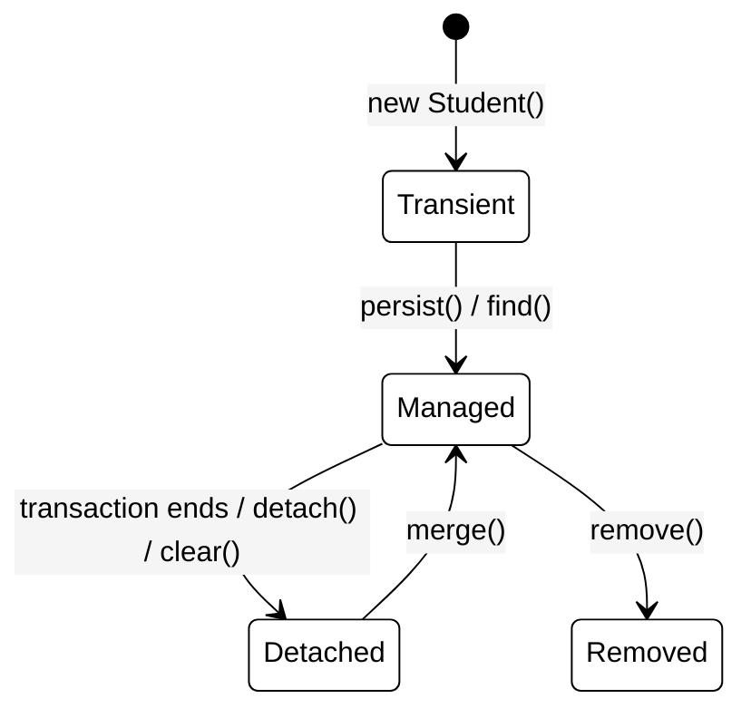

# Hibernate Internals — EntityManager, PersistenceContext & Transactions
### Last-minute interview cheat sheet

---

## 1. The Four Key Objects

| Object | Role |
|---|---|
| **EntityManager** | The API you actually talk to (JPA interface) — used to call `find`, `persist`, `remove`, `flush`, `clear`, `detach`, `merge` |
| **EntityManagerFactory** | Creates `EntityManager` instances (factory pattern). Lives for the **entire application's lifetime** |
| **PersistenceContext** | An in-memory **container/cache** that tracks entities fetched or saved during a transaction |
| **Transaction** | A unit of work — a group of operations that must all succeed or all fail together |



> 🔑 **Golden rule:** You NEVER talk to the database directly through `find`/`persist`/`remove`. You always talk to the **PersistenceContext** first — it only goes to the DB when necessary.

---

## 2. JPA vs Hibernate — The Interface Layering



- `Session` (Hibernate) is the original interface; `EntityManager` (JPA) came later as a **standardized** interface.
- Every method you call on `EntityManager` (find, persist, remove...) is ultimately a **Hibernate method** underneath.
- We almost always code against `EntityManager`/`EntityManagerFactory` (JPA layer) — never touch `Session`/`SessionFactory` directly.

> 🎯 **Interview line:** *"Hibernate predates JPA — it originally exposed `Session` and `SessionFactory`. JPA standardized this with `EntityManager` and `EntityManagerFactory`, which Hibernate implements internally. We always code to the JPA interfaces, and Hibernate does the real work underneath."*

---

## 3. `@PersistenceContext` — What It Actually Does

```
@PersistenceContext
private EntityManager entityManager;
```

- **`EntityManager` cannot be a singleton bean** — it's not thread-safe (multiple threads calling `find`/`persist` simultaneously would corrupt shared state).
- `@PersistenceContext` injects a **proxy**. The *real* `EntityManager` is only created fresh **each time a `@Transactional` method is called**.
- One new `EntityManager` → one new `PersistenceContext`, scoped to that single transaction/method call.



> 💡 Within the **same method call** (same transaction), calling `find()` twice for the same ID only hits the database **once** — the second call is served directly from the PersistenceContext (no SQL query runs).

---

## 4. Transactions — Why They Matter

Classic example: transferring money between two accounts:
```
BEGIN;
UPDATE accounts SET balance = balance - 1000 WHERE id = 1;
UPDATE accounts SET balance = balance + 1000 WHERE id = 2;
COMMIT;
```
- If the second query fails, the **whole transaction rolls back** — the first deduction is undone too.
- This all-or-nothing guarantee is why we call it a **unit of work**.

### How Spring simplifies this (vs raw Hibernate):
**Raw Hibernate:**
```
Session session = sessionFactory.openSession();
Transaction tx = session.beginTransaction();
try {
    session.persist(student);
    tx.commit();
} catch (Exception e) {
    tx.rollback();
}
```
**Spring:**
```
@Transactional
public void createStudent(Student student) {
    studentRepository.save(student);
}
```
- `@Transactional` uses **AOP** (Aspect-Oriented Programming) internally — an "around advice" wraps your method: begins the transaction before, commits after success, rolls back on exception.
- This is the exact same pattern used elsewhere in Spring AOP (pointcuts tracking annotations).

> ⚠️ **Common mistake:** Forgetting `@Transactional` on update/delete methods — the operation silently won't persist correctly (or update queries never flush). Read-only operations (like `getStudentById`) don't strictly need it, but adding it doesn't hurt.

> 🔑 Put `@Transactional` on the **Service layer**, not the Repository layer — repository's job is just to run queries; transaction management is a service-layer concern (also where AOP typically intercepts).

---

## 5. The "Magic" Update — Dirty Checking Explained Step by Step

```
@Transactional
public Student updateStudent(Long id, Student request) {
    Student student = studentRepository.findById(id); // SELECT query runs (or fetched from PersistenceContext)
    student.setName(request.getName());
    student.setAge(request.getAge());
    student.setEmail(request.getEmail());
    return student; // NO explicit save/update call!
}
```

### What happens internally:
1. `findById` → EntityManager asks PersistenceContext: *"Do you have Student #1?"* → No → queries DB via JDBC → `SELECT * FROM students WHERE id = 1`.
2. Result is loaded into a **heap object** AND simultaneously tracked inside the **PersistenceContext**.
3. You call `.setName()`, `.setAge()`, `.setEmail()` — these just mutate the **heap object** directly.
4. As the transaction is about to end, Hibernate checks: *"Does this tracked object still match what's in the database?"*
5. If it's changed → this is called a **dirty entity**.
6. Hibernate automatically generates and runs an `UPDATE` query to sync the DB with your changes — **you never called `update()` yourself.**

> 🎯 **Interview line:** *"There's no explicit update method in JPA/Hibernate. Instead, once an entity is 'managed' (tracked by the PersistenceContext), any changes to its fields are detected as a 'dirty' state, and Hibernate auto-generates the UPDATE query when the transaction flushes/commits."*

---

## 6. Entity Lifecycle States (Very Common Interview Topic!)



| State | Meaning |
|---|---|
| **Transient** | Just a plain Java object (`new Student()`) — not yet known to any PersistenceContext |
| **Managed** | PersistenceContext is actively tracking it (via `find()` or `persist()`) — any field changes trigger dirty checking → auto UPDATE |
| **Detached** | Was managed, but no longer tracked (transaction ended, or explicitly `detach()`ed / `clear()`ed) — field changes are **NOT** auto-persisted |
| **Removed** | Marked for deletion via `remove()` — a `DELETE` query runs on flush |

### Key EntityManager methods for lifecycle control:
| Method | Effect |
|---|---|
| `entityManager.detach(entity)` | Removes ONE entity from tracking — future changes won't auto-persist |
| `entityManager.clear()` | Detaches **ALL** entities being tracked by the PersistenceContext |
| `entityManager.merge(entity)` | Re-attaches a detached entity back into Managed state (returns the now-managed instance) |
| `entityManager.contains(entity)` | Returns `true`/`false` — is this entity currently managed? |
| `entityManager.refresh(entity)` | Re-fetches from DB, overwriting in-memory state — useful if DB was changed directly (outside the app) |

> ⚠️ If you `detach()` an entity and then modify it without calling `merge()` first, your changes will **NOT** be saved to the database — only the `SELECT` runs, no `UPDATE`.

---

## 7. `flush()` — Understanding "Write-Behind" Behavior

- The PersistenceContext is called a **write-behind cache**: changes aren't written to the DB immediately — only when it's about to end (or is manually flushed).
- `entityManager.flush()` forces an immediate sync between the PersistenceContext and the database (runs pending INSERT/UPDATE/DELETE queries right now).
- **Why wait instead of flushing after every field change?** Efficiency — if you call `setName()`, `setAge()`, `setEmail()` in sequence, flushing after *each* would mean 3 separate DB round-trips instead of 1 combined UPDATE at the end.

```
// Calling flush() manually after every change = 3 separate UPDATE queries (inefficient!)
student.setName(...);
studentRepository.flush();
student.setAge(...);
studentRepository.flush();
student.setEmail(...);
studentRepository.flush();
```

### Real use case for manual flush — Batch Processing
When persisting millions of records, don't let the PersistenceContext grow unbounded (it will slow the app down):

```
int counter = 0;
for (Student student : millionsOfStudents) {
    entityManager.persist(student);
    counter++;
    if (counter % 100 == 0) {
        entityManager.flush(); // push this batch of 100 to the DB
        entityManager.clear(); // free up memory — stop tracking them
    }
}
```
- This inserts in **batches of 100** instead of holding a million tracked objects in memory or hitting the DB with one massive insert.

---

## 8. PersistenceContext = First-Level Cache (L1 Cache)

- Every entity fetched or saved is automatically cached in the PersistenceContext for the duration of the transaction.
- Repeated `find()` calls for the same ID within the same transaction **never hit the database twice**.
- This is officially called Hibernate's **first-level cache (L1)** — always enabled by default, scoped to one EntityManager/transaction.
- (A **second-level cache** also exists, shared across sessions — covered separately, not the focus here.)

---

L2 cache is Hibernate’s shared cache across multiple transactions/sessions.
L2 cache avoids repeated DB hits across different transactions by storing entities in a shared application-level cache.

Transaction 1:
find Student #1
L1 empty -> DB query -> store in L1 + L2

Transaction 2:
find Student #1
new L1 is empty -> checks L2 -> gets Student #1 without DB query

## 9. Interview-Ready Summary (30-second answer)

> "Hibernate never lets you talk to the database directly through `find`/`persist`/`remove` — you're always talking to the **PersistenceContext**, an in-memory container that tracks entities as a first-level cache. The `EntityManager` (a JPA interface, backed by Hibernate's `Session`) is the API for this, and it's created fresh per transaction by the `EntityManagerFactory`, since `EntityManager` isn't thread-safe. When you fetch an entity, it becomes 'managed' — any field changes are detected via **dirty checking**, and Hibernate auto-generates the UPDATE query when the transaction flushes, which is why there's no explicit `update()` method. Entities move through four lifecycle states — Transient, Managed, Detached, Removed — and understanding this explains why an update silently fails to persist if the entity was `detach()`ed or the transaction lacked `@Transactional`."

---

### Quick Fire Q&A

- **Q: Why can't `EntityManager` be a singleton bean?**
  A: It's not thread-safe — concurrent `find`/`persist`/`remove` calls from multiple threads would corrupt shared state. A new one is created per transaction via `@PersistenceContext`.

- **Q: What are the four entity lifecycle states?**
  A: Transient (plain object, untracked) → Managed (tracked, dirty-checked) → Detached (untracked again) or Removed (marked for deletion).

- **Q: How does Hibernate know to run an UPDATE without an explicit update() call?**
  A: Dirty checking — it compares the managed entity's current field values against what was originally loaded, and if different, auto-generates an UPDATE at flush time.

- **Q: What does `flush()` do, and why doesn't Hibernate do it after every change?**
  A: `flush()` syncs the PersistenceContext with the DB immediately. It's deferred by default ("write-behind") to batch multiple changes into fewer DB round-trips for efficiency.

- **Q: What's the difference between `detach()` and `clear()`?**
  A: `detach()` removes one specific entity from tracking; `clear()` detaches everything in the current PersistenceContext.

- **Q: How do you re-attach a detached entity?**
  A: `entityManager.merge(entity)` — returns a new managed instance reflecting the merged state.

- **Q: Why is PersistenceContext called a "first-level cache"?**
  A: Because entities fetched/saved during a transaction are cached in memory, avoiding repeated DB queries for the same entity within that same transaction/EntityManager scope.

- **Q: When would you manually call `flush()` and `clear()`?**
  A: Batch processing large datasets — periodically flushing and clearing (e.g., every 100 records) to avoid unbounded memory growth and reduce the number of DB round-trips.
