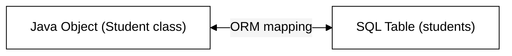
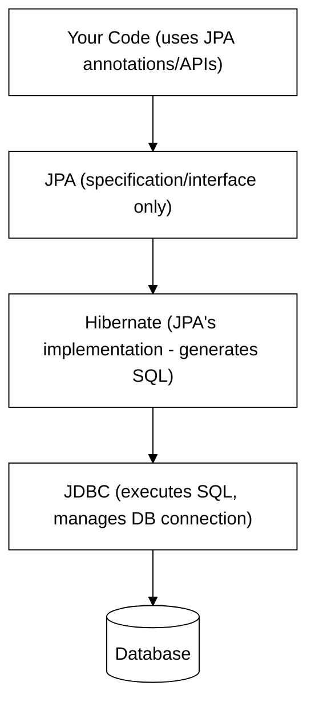
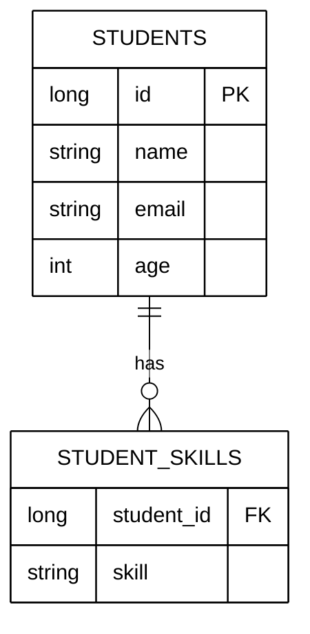

# Hibernate & JPA Fundamentals
### Last-minute interview cheat sheet

---

## 1. The Core Problem — Object-Relational Impedance Mismatch

- A **Java object** represents data using classes, inheritance, polymorphism.
- A **SQL table** represents data using rows, columns, primary/foreign keys.
- These two representations are fundamentally different — this difference is called **Object-Relational Impedance Mismatch**.

**Without an ORM (e.g., plain JDBC):**
- You manually write every SQL query (INSERT, UPDATE, SELECT).
- You manually map each `ResultSet` row → Java object field-by-field (a `RowMapper`).
- This tightly couples your Java code to your database and is repetitive/error-prone.

---

## 2. What is an ORM?

**ORM = Object-Relational Mapping.** It automatically maps:
- Class name → Table name
- Class fields/properties → Table columns
- Object instances → Table rows



### Responsibilities of an ORM framework:
1. **Metadata mapping** — class ↔ table, fields ↔ columns.
2. **Auto-generates SQL queries** (INSERT/UPDATE/SELECT) — since the syntax pattern is always the same, only values change.
3. **Parameter binding** — extracting field values from the object into the query.
4. **Result set mapping** — converting query results back into objects automatically.
5. **Manages relationships** between entities (one-to-many, many-to-many, etc.).
6. **Caching** — avoids repeated DB calls, reducing latency.
7. **Transaction integration** — makes handling atomic operations easier.

---

## 3. JPA vs Hibernate (Very Common Interview Question!)

| | JPA | Hibernate |
|---|---|---|
| What it is | A **specification/interface** — defines rules & annotations (`@Entity`, `@Id`, etc.) | An actual **ORM framework** — a concrete **implementation** of JPA |
| Does it talk to the DB? | No — it just defines the contract | Yes — Hibernate does the real work of generating & executing SQL |
| Can it be swapped? | Yes — JPA doesn't require Hibernate specifically | Hibernate is Spring's **official/default** JPA implementation, but others exist (EclipseLink, etc.) |



> 🎯 **Interview line:** *"JPA is just a specification — it defines what should happen, not how. Hibernate is the actual ORM implementation that does the work, and internally, Hibernate itself uses JDBC to execute the generated SQL and manage the database connection."*

---

## 4. Setup — `application.properties`

```
spring.datasource.url=jdbc:mysql://localhost:3306/student_db
spring.datasource.username=root
spring.datasource.password=yourpassword

spring.jpa.hibernate.ddl-auto=update
spring.jpa.show-sql=true
spring.jpa.properties.hibernate.format_sql=true
```

- `spring-boot-starter-data-jpa` dependency automatically brings in Hibernate (since Hibernate is JPA's default implementation).
- Still need the DB driver dependency (e.g., `mysql-connector-j`) since Hibernate uses JDBC underneath.

### `ddl-auto` options (important!):

| Value | Behavior |
|---|---|
| `create` | Drops and recreates the table **every time the app starts** — all old data is lost |
| `update` | Only applies schema changes (new columns, etc.) without dropping existing data |
| `none` | Does nothing — you manage the schema manually via SQL |
| `validate` | Checks that entity fields match existing table schema; throws an error if mismatched |

> ⚠️ **In production**, none of these DDL-auto options are used — dedicated migration tools like **Flyway** or **Liquibase** are used instead. `create`/`update` are only for dev/demo purposes.

---

## 5. The Core Building Blocks

### `@Entity` + `@Id` + `@GeneratedValue`
```
@Entity
public class Student {

    @Id
    @GeneratedValue(strategy = GenerationType.IDENTITY)
    private Long id;

    private String name;
    private String email;
    private int age;
}
```
- `@Entity` → maps this class to a database table (table name defaults to the class name, lowercased).
- `@Id` → marks the primary key field.
- `@GeneratedValue(strategy = GenerationType.IDENTITY)` → auto-increments the ID (1, 2, 3...).

### `EntityManager` — the core API for DB operations
```
@PersistenceContext
private EntityManager entityManager;
```
- Injected via `@PersistenceContext`.
- Key methods:

| Method | Purpose |
|---|---|
| `entityManager.persist(student)` | **Create** — inserts a new row |
| `entityManager.find(Student.class, id)` | **Read** — fetches by primary key |
| `entityManager.remove(student)` | **Delete** — removes the entity (pass the *object*, not just the ID) |

> 🔑 **No explicit "update" method exists!** Hibernate auto-detects changes to a **managed entity** (one fetched via `find`) and generates the UPDATE query automatically when the transaction commits. This is called **dirty checking**.

```
// "Magic" update — no explicit update call needed
Student student = entityManager.find(Student.class, id);
student.setName(newName);
student.setAge(newAge);
// Hibernate automatically issues an UPDATE query at commit time
```

### `@Transactional`
```
@Transactional
public void createStudent(Student student) {
    studentRepository.save(student);
}
```
- Wraps the operation in a database transaction — **required** for update/delete operations to actually commit (without it, changes may not persist).
- Ensures atomicity: the whole operation succeeds or fails as one unit.

---

## 6. Customizing the Mapping — Key Annotations

### `@Table` (optional — overrides default table name)
```
@Entity
@Table(name = "students")
public class Student { ... }
```

### `@Column` (customizes a field's column mapping)
```
@Column(name = "student_name", nullable = false, unique = true, length = 100)
private String name;
```

| Attribute | Meaning |
|---|---|
| `name` | Custom column name in the DB |
| `nullable` | Whether the column can store `NULL` |
| `unique` | Enforces uniqueness across rows |
| `length` | Max character length (for Strings) |
| `insertable` / `updatable` | Whether this column participates in INSERT / UPDATE queries |
| `precision`, `scale` | For `BigDecimal` — total digits, and digits after decimal point |

### Data type mapping examples
| Java Type | SQL Type |
|---|---|
| `String` | VARCHAR |
| `int` / `Integer` | INT |
| `BigDecimal` | DECIMAL (use with `precision`/`scale`) |
| `LocalDate` | DATE |
| `LocalTime` | TIME |
| `LocalDateTime` | TIMESTAMP |

### `@Enumerated` — storing enums
```
public enum StudentStatus { ACTIVE, INACTIVE, SUSPENDED }

@Enumerated(EnumType.STRING)
private StudentStatus status;
```
- `EnumType.STRING` → stores the enum name as text (e.g., `"ACTIVE"`) — **preferred**, more readable.
- `EnumType.ORDINAL` → stores the enum's index (0, 1, 2...) — avoid, since reordering enum values breaks existing data.

### `@Lob` — large objects
```
@Lob
private String profileDescription;
```
- Maps to a large text/binary column (e.g., `LONGTEXT`).
- ⚠️ Best practice: don't store large files/blobs directly in DB — use external storage (e.g., S3) and store just the URL.

### `@Transient` — exclude from persistence
```
@Transient
private String displayName;
```
- Field exists in the Java object only — **not** mapped to any column.

---

## 7. Custom Type Conversion — `AttributeConverter`

Use case: store a Java `boolean` as `"YES"`/`"NO"` in the DB instead of `true`/`false` or `0`/`1`.

```
@Converter
public class BooleanToStringConverter implements AttributeConverter<Boolean, String> {

    @Override
    public String convertToDatabaseColumn(Boolean attribute) {
        return (attribute != null && attribute) ? "YES" : "NO";
    }

    @Override
    public Boolean convertToEntityAttribute(String dbData) {
        return "YES".equals(dbData);
    }
}
```
```
@Convert(converter = BooleanToStringConverter.class)
private boolean isMonitor;
```

---

## 8. Embedding Objects — `@Embeddable` + `@Embedded`

Use when an object **cannot exist independently** — it's only meaningful as part of its parent (a composition relationship).

Example: `Address` doesn't make sense on its own — it only exists as part of a `Student`.

```
@Embeddable
public class Address {
    private String houseNumber;
    private String street;
    private String city;
    private String state;
    private String pincode;
}
```
```
@Embedded
private Address address;
```
- Result: `Address` fields are added **directly as columns in the `students` table** — no separate table is created.

### Multiple embedded objects of the same type → `@AttributeOverrides`
If a `Student` has both `currentAddress` and `permanentAddress` (both type `Address`), column names would clash. Fix with:
```
@Embedded
@AttributeOverrides({
    @AttributeOverride(name = "houseNumber", column = @Column(name = "current_house_number")),
    @AttributeOverride(name = "street", column = @Column(name = "current_street"))
    // ... etc for city, state, pincode
})
private Address currentAddress;
```

> 🔑 **Rule of thumb:** If the object can logically exist on its own (e.g., a `Department`), it should be its **own `@Entity`** with a separate table and a relationship mapping (one-to-many, etc.) — not `@Embeddable`.

---

## 9. Storing Collections — `@ElementCollection`

For a `Set<String>` or similar collection of simple values (or embeddable objects) — Hibernate creates a **separate table** automatically.

```
@ElementCollection
@CollectionTable(name = "student_skills", joinColumns = @JoinColumn(name = "student_id"))
@Column(name = "skill")
private Set<String> skills;
```



- `@CollectionTable(name=...)` — names the new table.
- `@JoinColumn(name=...)` — names the foreign key column linking back to the owning entity.
- Works the same way for a collection of `@Embeddable` objects (e.g., `Set<Address>` → generates a `student_address` table with a `student_id` foreign key) — this is how **one-to-many** relationships are represented under the hood for simple/embeddable collections.

> 💡 The generated child table typically has **no own primary key** by default — just the foreign key + value columns — unless you make it a full `@Entity` yourself.

---

## 10. Interview-Ready Summary (30-second answer)

> "Hibernate is an ORM (Object-Relational Mapping) framework that solves the object-relational impedance mismatch — the fact that Java objects and SQL tables represent data very differently. It automatically maps class names to tables and fields to columns, generates SQL queries, handles parameter binding and result-set mapping, and manages transactions and caching. JPA, in contrast, is just a specification/interface — Hibernate is its concrete implementation, and Hibernate itself uses JDBC internally to actually talk to the database. Core annotations like `@Entity`, `@Id`, `@Column`, `@Embeddable`, and `@ElementCollection` define how a class maps to tables and columns, while `EntityManager` methods (`persist`, `find`, `remove`) combined with Hibernate's automatic **dirty checking** (detecting changes on a managed entity and auto-generating UPDATE queries) let you perform CRUD operations without writing a single line of SQL."

---

### Quick Fire Q&A

- **Q: What's the difference between JPA and Hibernate?**
  A: JPA is a specification (interface/rules); Hibernate is a concrete ORM framework that implements JPA and does the actual DB interaction (via JDBC internally).

- **Q: How does Hibernate perform an "update" without an explicit update method?**
  A: Dirty checking — when you fetch a managed entity via `EntityManager.find()`, modify its fields, and the transaction commits, Hibernate detects the changes and auto-generates the UPDATE query.

- **Q: What's the difference between `@Embeddable` and creating a separate `@Entity`?**
  A: `@Embeddable` is for objects that can't exist independently (composition) — its fields get merged into the parent's table, no separate table created. A separate `@Entity` is used when the object has independent existence and needs its own table + relationship mapping.

- **Q: Why use `EnumType.STRING` over `EnumType.ORDINAL`?**
  A: STRING stores the readable enum name; ORDINAL stores just the index, which breaks if enum values are reordered later.

- **Q: What does `ddl-auto=update` do differently from `create`?**
  A: `update` only applies schema changes (adds new columns) while preserving existing data; `create` drops and recreates the table every startup, losing all data.

- **Q: Why is `@Transactional` needed for update/delete operations?**
  A: It wraps the operation in a database transaction, ensuring changes are properly committed — without it, updates especially may not persist reliably.

- **Q: How does Hibernate store a `Set<String>` field?**
  A: Via `@ElementCollection`, which creates a separate table (named via `@CollectionTable`) with a foreign key back to the parent entity (via `@JoinColumn`).
